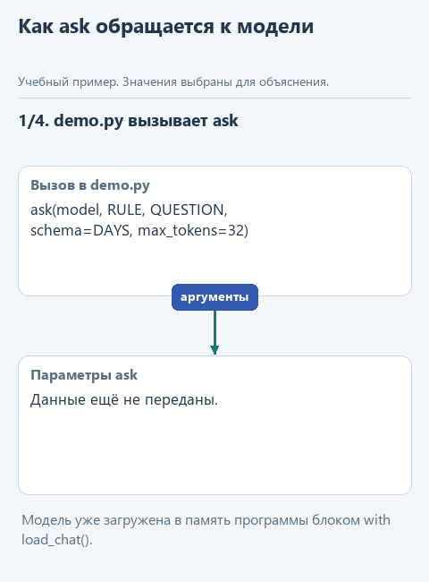
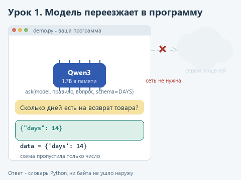
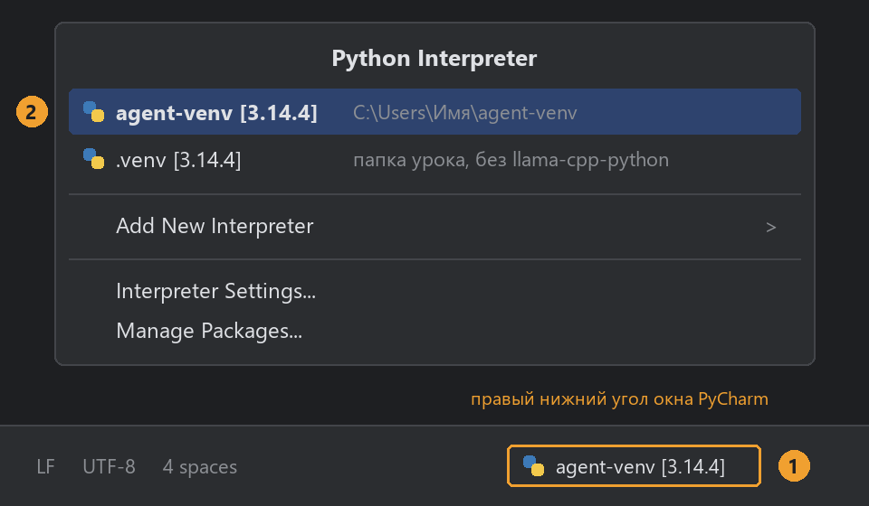

# Урок 1. Модель внутри программы: Загружаем Qwen3 на CPU

[Открыть исходники этого урока](../exercises/lesson-01-runtime/README.md) / [Подсказки рядом с кодом](../exercises/lesson-01-runtime/TASK.md)

> **Где мы находимся:** Начинаем вторую ступень! 
> 
> В первой части курса мы отправляли сетевые запросы к модели через интернет или локальный сервер.
> 
> Сейчас мы делаем шаг к максимальной автономности: загружаем языковую модель прямо в память нашего процесса Python через высокоскоростную библиотеку `llama-cpp-python`. Модель работает на обычном процессоре вашего ноутбука, не требует видеокарты и интернета и гарантированно возвращает строгий JSON по заданной схеме:
> 
> `[Память Python] -> загрузка GGUF-модели -> функция ask() -> ответ по схеме JSON`

---

## Как устроена модель внутри процесса?

Когда вы пользуетесь ChatGPT или Ollama, нейросеть работает как отдельная удалённая программа. Вы отправляете ей сетевой запрос по HTTP, ждёте ответ и парсите его.

В этом уроке мы поступаем иначе:
1. Мы используем библиотеку **`llama-cpp-python`** - это высокопроизводительный движок на C++, скомпилированный специально для запуска нейросетей на обычных процессорах с инструкциями AVX2.
2. Файл нейросети загружается **прямо в оперативную память вашего скрипта Python**.
3. Обращение к модели происходит не через сеть, а прямым вызовом функции в коде: `model.create_chat_completion(...)`.

### Что такое формат GGUF и квантование (сжатие)?
Файл модели хранится в формате **GGUF** (GPT-Generated Unified Format). Внутри него зашиты веса нейросети - около 1,7 миллиарда чисел, определяющих всё, чему модель научилась при тренировке.

В исходном виде такие веса занимают колоссальный объём памяти (16 бит на каждое число). Но разработчики научились сжимать их - этот процесс называется **квантованием (quantization)**:
* Числа округляют до 8 бит (вариант **Q8_0**) или до 4 бит (вариант **Q4_K_M**).
* Это похоже на сжатие несжатого звука WAV в качественный MP3: размер файла уменьшается в 2-4 раза (модель весит всего 1,8 ГБ вместо 7 ГБ!), а качество ответов для человека остаётся практически неотличимым.

В качестве рабочей лошадки нашего курса мы используем отличную современную модель **Qwen3-1.7B** в варианте Q8_0 из официального репозитория команды Alibaba. На обычном ноутбуке ответ на короткий вопрос занимает всего 1-3 секунды.



<details>
<summary>Посмотреть схему работы функции ask (статичный вариант)</summary>



</details>

---

## 1. Настройка окружения (один раз на весь курс)

Для работы с локальной моделью нам понадобится библиотека `llama-cpp-python`. Мы установим её в отдельное виртуальное окружение `agent-venv`. Это делается ровно **один раз**: все 7 уроков второй ступени будут использовать это общее окружение.

### Шаг 1.1. Распакуем и откроем каркас урока
1. Скачайте [архив урока](../downloads/lesson-01-runtime.zip?raw=true) и распакуйте его (правая кнопка мыши -> **Извлечь всё...**).
2. В PyCharm откройте папку `lesson-01-runtime` через меню **File -> Open**.

### Шаг 1.2. Проверим, установлена ли уже библиотека
В дереве файлов найдите проверочный скрипт `check_install.py`, щёлкните правой кнопкой мыши и выберите **Run 'check_install'**:
* Если внизу вывелось: `Библиотека загружена: 0.3.36` - поздравляем, всё готово, переходите сразу к пункту 2 ("Скачаем модель")!
* Если написано: `Библиотека пока не загрузилась` - создадим окружение за 2 минуты:

1. Откройте **File -> Settings** (на macOS: **PyCharm -> Settings**).
2. Перейдите в раздел **Project: lesson-01-runtime -> Python Interpreter**.
3. Нажмите **Add Interpreter -> Add Local Interpreter...**
4. Выберите слева **Virtualenv Environment**, переключите на **New**:
   * В поле **Location** укажите путь: `C:\Users\<Ваше_Имя>\agent-venv`.
   * В поле **Base interpreter** выберите установленный Python (версия 3.12, 3.13 или 3.14).
   * Нажмите **OK**.
5. Внизу PyCharm откройте вкладку **Terminal** (в начале строки должно появиться `(agent-venv)`).
6. Вставьте в терминал команду установки готового бинарного пакета:

```powershell
python -m pip install --only-binary=:all: -r requirements.txt
```

*(Флаг `--only-binary=:all:` гарантирует, что установятся предсобранные бинарники под Windows и система не будет требовать компилятор C++).*

7. Запустите `check_install.py` ещё раз - теперь появится заветное: `Библиотека загружена: 0.3.36`.



---

## 2. Скачаем модель (в общую папку)

В проекте есть готовый скрипт загрузки - `get_models.py`.

1. Откройте `get_models.py` двойным щелчком.
2. Щёлкните правой кнопкой мыши и выберите **Run 'get_models'**.
3. Скрипт скачает файл модели `Qwen3-1.7B-Q8_0.gguf` (около 1,8 ГБ) с HuggingFace в общую пользовательскую папку `agent-models` на вашем диске и будет показывать процент загрузки.

*Эта папка общая для всех уроков:* скачанный файл сохранится навсегда, и последующие уроки не будут скачивать его заново.

---

## 3. Секретное оружие локального ИИ: Генерация строго по схеме JSON

В первой части курса мы просили модель: *"Ответь в формате JSON"*. Но нейросети коварны: они могут случайно добавить в начало вежливое "Конечно! Вот ваш ответ:", забыть закрывающую кавычку или скобку, и функция `json.loads()` упадет с ошибкой.

У локального движка `llama-cpp-python` есть фантастическая возможность, которой нет у большинства веб-сервисов - **грамматически ограниченное декодирование (Grammar-Constrained Decoding)**:

Мы передаём движку строгую схему допустимого ответа:

```python
DAYS_SCHEMA = {
    'type': 'object',
    'properties': {
        'days': {'type': 'integer'}
    },
    'required': ['days']
}
```

Что происходит под капотом движка?
Когда нейросеть предсказывает каждый следующий токен (букву или слово), C++ движок на лету фильтрует словарь: **он физически блокирует любые токены, которые нарушают формат JSON**!
* Модель не может написать букву вместо цифры в поле `days`.
* Модель не может написать вступительное слово.
* Ответ **всегда** будет стопроцентно валидным JSON: `{"days": 14}`.

---

## 4. Напишите код сами: главная функция `ask`

Откройте файл `local_llm.py` и найдите функцию `ask`:

```python
def ask(model, instruction: str, text: str, schema: dict | None = None, max_tokens: int = 256):
    settings = dict(SAMPLING, max_tokens=max_tokens)
    if schema is not None:
        settings['response_format'] = {'type': 'json_object', 'schema': schema}
    raise NotImplementedError('Допишите ask в local_llm.py по подсказкам урока 1')
```

Замените строчку `raise NotImplementedError(...)` следующим кодом и заполните два пропуска `...`:

```python
    messages = [
        {'role': 'system', 'content': instruction + NO_THINK},
        {'role': 'user', 'content': ...},
    ]
    response = model.create_chat_completion(messages=..., **settings)
    answer = clean_answer(response)
    if schema is not None:
        return json.loads(answer)
    return answer
```

1. В сообщении с ролью `'user'` передайте входящую переменную: `text`.
2. В метод `model.create_chat_completion` передайте наш список сообщений: `messages=messages`.
3. Функция `clean_answer` автоматически достанет текст ответа и очистит служебные теги.
4. Если была задана `schema`, функция распарсит строку через `json.loads(answer)` и вернёт готовый словарь Python с числом, а не просто текст!

---

## 5. Запустим и проверим

В проекте есть два запуска:

### 1. Быстрая проверка без модели (`demo_check.py`)
Откройте `demo_check.py` и запустите его (**Run 'demo_check'**). Он мгновенно вызовет вашу функцию `ask` на подставном фейковом объекте.
Внизу появится:
```text
Проверка без модели: Вернуть товар можно в течение 14 дней.
```
Это значит, что структура функции написана правильно!

### 2. Полноценный запуск с реальной моделью (`demo.py`)
Теперь откройте `demo.py` и запустите его (**Run 'demo'**).
Программа загрузит модель в память и выведет:

```text
Загружаем Qwen3-1.7B-Q8_0.gguf...
Вопрос: В течение какого срока можно вернуть товар надлежащего качества?
Ответ модели: Вернуть товар надлежащего качества можно в течение 14 дней.
Время ответа, сек: 1.4
Ответ по схеме: {'days': 14} - тип: int
```

Посмотрите на последнюю строчку:
`{'days': 14} - тип: int` - модель не просто ответила текстом, она вернула настоящее число `14`, готовое для вычислений в коде!

---

## Под капотом: как устроен проект урока и модуль local_llm.py

Модуль `local_llm.py` - это ядро всей второй ступени. Он будет присутствовать во всех последующих уроках.

### Карта файлов урока `lesson-01-runtime`

```text
lesson-01-runtime/
├── check_install.py   # Быстрый тест: видит ли PyCharm библиотеку llama-cpp-python
├── get_models.py      # Утилита загрузки модели с HuggingFace в общую папку
├── local_llm.py       # Главный модуль: загрузка движка, очистка ответов и наша функция ask()
├── demo_check.py      # Моментальная проверка логики без загрузки тяжёлых весов
└── demo.py            # Боевой запуск реальной модели на CPU
```

### Анатомия управления памятью: почему используется `@contextmanager`?

В `local_llm.py` модель загружается через контекстный менеджер:

```python
@contextmanager
def load_chat(name: str | None = None, n_ctx: int = 4096):
    path = require(name or chat_model_name())
    from llama_cpp import Llama
    model = Llama(model_path=str(path), n_ctx=n_ctx, n_gpu_layers=0, verbose=False)
    try:
        yield model
    finally:
        model.close()
```

Зачем это нужно?
Файл модели занимает почти 2 гигабайта оперативной памяти. Если загрузить модель как глобальную переменную и забыть освободить память, ваш ноутбук быстро исчерпает ресурсы.

Конструкция `try ... finally: model.close()` гарантирует: как только блок `with load_chat() as model:` завершился (или если внутри произошла ошибка), память C++ движка **будет немедленно и полностью освобождена**.

---

> 💡 **Для тех, кто хочет вникнуть глубже:** Полный построчный разбор всех функций, классов и структур модуля `local_llm.py` доступен в отдельном материале: [Дополнительно: Как устроен модуль local_llm.py](01-local-llm-module.md).

---

## Итог урока

* Мы настроили единое рабочее окружение `agent-venv` и скачали локальную модель Qwen3 на CPU.
* Мы научились запускать модель прямо внутри Python-процесса без интернета и сторонних серверов.
* Мы освоили генерацию по схеме JSON - теперь модель гарантированно возвращает строгие структурированные данные.

---

## Что дальше

Теперь у нас в руках есть работающий локальный ИИ. В следующем уроке мы встроим его в настоящее настольное приложение с графическим окном и научим обрабатывать журнал проделок кота из файла Excel!

-> [Урок 2. Журнал проделок кота: Модель в настольном приложении](02-cat-journal.md)
