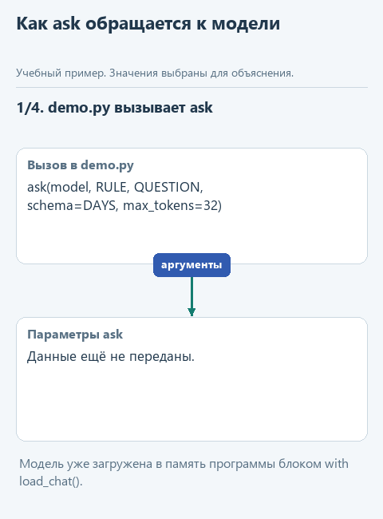
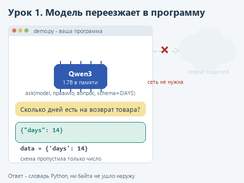
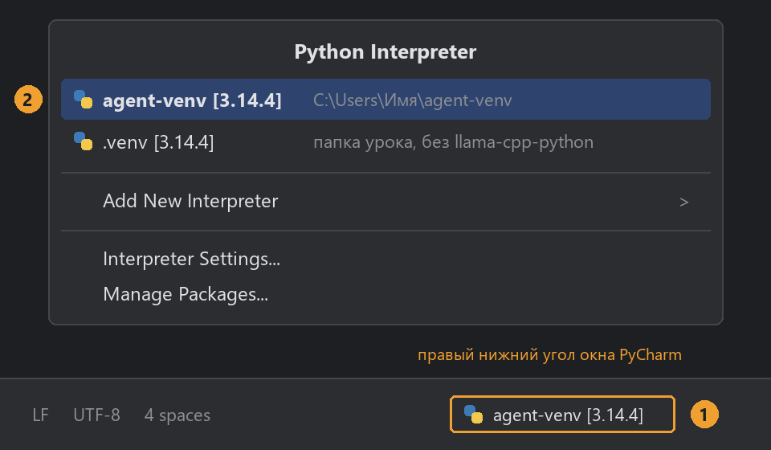

# Урок 1. Модель внутри программы

[Исходники урока](../exercises/lesson-01-runtime/README.md) / [Подсказки рядом с кодом](../exercises/lesson-01-runtime/TASK.md)

> **Где мы.** Собираем общий модуль, через который все уроки курса будут обращаться к локальной модели. Сегодня пишем в нём функцию `ask`.
> **Из основного курса:** два сообщения с ролями `system` и `user` из `build_messages`, разбор ответа из `extract_answer`, необязательный урок о запуске модели из Python.
> **Новое:** модель живёт в памяти нашей программы, один модуль загрузки на весь курс, ответ строго по схеме JSON.
> `вопрос -> ask -> [сообщения -> модель в памяти программы] -> текст или словарь`

Вернёмся к вопросу клиента из основного курса: "Сколько дней есть на возврат товара?" и к пункту регламента "Возврат товара возможен в течение 14 дней". Тогда программа отправляла эти данные по сети: функция `send_live` делала HTTP-запрос к OpenRouter, VseGPT или Ollama, а модель работала в отдельном приложении. Чтобы получить ответ, это приложение должно было быть запущено и доступно.

Теперь модель станет частью нашей программы. Файл модели загружается в её память, вызов идёт обычной функцией Python, и ни одного байта не уходит наружу. Такое устройство выбирают, когда программа должна работать без сети, когда нельзя ставить на компьютер отдельный сервис или когда данные не должны покидать машину. В [необязательном уроке основного курса](https://github.com/polar-byter/agent-harness-workshop/blob/main/course/02-note-assistant/extra-local.md) мы уже пробовали так запускать модель. Во второй ступени это основной способ, и сегодня мы сделаем его удобным для всех следующих уроков.

## Кто выполняет вычисления

В основном курсе модель считала чужая программа: в OpenRouter - серверы сервиса, в Ollama - отдельное приложение на вашем компьютере. Наша программа только отправляла им текст и ждала ответа. Теперь считать будет она сама, и для этого ей нужен движок - код, который умеет загрузить обученную модель и прогнать через неё текст.

Таким движком будет llama.cpp, один из самых популярных способов запускать модели на обычном процессоре. Он написан на C++, а из Python к нему обращаются через библиотеку `llama-cpp-python`. Для Windows у неё есть готовая сборка, поэтому ничего компилировать не придётся.

Саму модель движок читает из файла формата GGUF. В нём лежит всё, что модель выучила при обучении, - её параметры, больше миллиарда чисел, - и сведения о том, как их загрузить. Чтобы такой файл поместился в память ноутбука, числа хранят сжатыми, и степень сжатия видна в названии файла. В варианте Q8_0 на каждый параметр приходится около 8 бит вместо 16 у исходной модели: файл вдвое меньше, а качество ответов обычно почти не меняется. Вариант Q4_K_M, который встретится в уроке 4, сжат ещё сильнее.

Основная модель курса - Qwen3-1.7B в варианте Q8_0, файл около 1,8 ГБ, из [официального репозитория Qwen](https://huggingface.co/Qwen/Qwen3-1.7B-GGUF). В основном курсе мы брали младшую Qwen3-0.6B, но для задач второй ступени она слабовата: при подготовке курса на семи записях о проделках кота она верно определила категорию шести, а Qwen3-1.7B - всех семи. Если ноутбук совсем слабый, можно взять и 0,6B, способ описан ниже. На компьютере, где проверялся курс, короткий ответ 1,7B занимал около секунды; на обычном ноутбуке он займёт несколько секунд.



<details>
<summary>Статичный вариант</summary>



</details>

## Одно окружение на весь курс

До сих пор программам курса хватало стандартной библиотеки Python. Чтобы запускать модель внутри программы, нужен внешний пакет `llama-cpp-python`. Его ставят в виртуальное окружение - отдельную папку со своим Python и пакетами. Так пакеты курса не смешиваются с другими вашими проектами, а удалить их можно вместе с папкой. Окружение создаётся один раз на весь курс, а в каждом уроке его выбирают в PyCharm.

Окружение нужно только для запуска настоящей модели: `demo.py` в этом уроке и примеры в следующих. `demo_check.py` и тесты работают без него.

**Сначала проверьте, нужен ли этот шаг.** Скачайте [архив урока](../downloads/lesson-01-runtime.zip?raw=true), распакуйте через **Извлечь всё** и откройте папку `lesson-01-runtime` в PyCharm через **File -> Open**. Откройте `check_install.py` и выберите **Run 'check_install'**. Если в окне Run есть строка `Библиотека загружена: 0.3.36`, библиотека уже стоит в интерпретаторе этого проекта: переходите к разделу [Скачаем модель](#скачаем-модель). Если там `Библиотека пока не загрузилась`, создайте окружение:

1. Откройте **File -> Settings -> Project: lesson-01-runtime -> Python Interpreter**, нажмите **Add Interpreter -> Add Local Interpreter**.
2. Выберите **Virtualenv Environment** и вариант **New**. В поле **Location** укажите `C:\Users\Имя\agent-venv`, где `Имя` - ваша папка пользователя. В **Base interpreter** выберите Python 3.14. Нажмите **OK**.
3. Откройте **View -> Tool Windows -> Terminal**. В начале строки должно появиться `(agent-venv)`. Если его нет, закройте вкладку терминала и откройте новую. Введите:

```powershell
python -m pip install --only-binary=:all: -r requirements.txt
```

Флаг `--only-binary=:all:` разрешает только готовые пакеты: если для вашей системы подходящего нет, установка остановится с понятной ошибкой, а не начнёт собирать C++. В `requirements.txt` записан адрес сборки `llama-cpp-python` 0.3.36 для Windows x64, она подходит для любой версии Python 3.

4. Снова запустите `check_install.py`. В окне Run появятся путь к Python, строка `Библиотека загружена: 0.3.36` и папка моделей. Если терминал сообщил об успешной установке, а `check_install` библиотеку не нашёл, значит, проект и терминал используют разные интерпретаторы: проверьте пункт 1.

В следующих уроках окружение создавать не нужно, его достаточно выбрать. Удобнее всего это сделать в правом нижнем углу окна PyCharm: там написано имя текущего интерпретатора, например `.venv [3.14.4]`. Щёлкните его, и откроется список. Если вы уже выбирали `agent-venv` в другом проекте, PyCharm обычно показывает его здесь, и достаточно щёлкнуть строку. Если его в списке нет, выберите **Add New Interpreter -> Add Local Interpreter**, затем существующее окружение и путь `C:\Users\Имя\agent-venv\Scripts\python.exe`. Если библиотека у вас стоит в другом интерпретаторе, можно выбрать его.



Иногда при открытии папки урока PyCharm предлагает или сам создаёт в ней окружение `.venv`. В нём нет `llama-cpp-python`, и `demo.py` напишет `No module named 'llama_cpp'`. Переключитесь на `agent-venv` так, как показано на картинке.

## Скачаем модель

Откройте `get_models.py` и выберите **Run 'get_models'**. Программа скачает файл `Qwen3-1.7B-Q8_0.gguf` в папку `C:\Users\Имя\agent-models` и будет печатать проценты. Эта папка общая для всего курса: следующие уроки возьмут модель оттуда и не будут скачивать её снова.

<details>
<summary>Маленькая модель или другой диск</summary>

Чтобы скачать Qwen3-0.6B вместо 1,7B, откройте **Run -> Edit Configurations...**, выберите `get_models`, впишите в поле **Script parameters** слово `small` и запустите снова. Если в общей папке есть только маленькая модель, курс будет использовать её.

Чтобы хранить модели на другом диске, задайте переменную окружения `AGENT_MODELS_DIR` с путём к папке, например `D:\agent-models`: **Пуск -> Изменение переменных среды для вашей учётной записи -> Создать**. После этого перезапустите PyCharm.

</details>

## Посмотрим на общий модуль

Откройте `local_llm.py`. Этот файл будет лежать в каждом каркасе курса без изменений. Сверху словарь `MODELS`: для каждой модели курса - имя файла, адрес и примерный размер. Функция `models_dir` возвращает общую папку моделей, `download` скачивает недостающие файлы.

Ниже функция `load_chat`. Её используют в блоке `with`:

```python
with load_chat() as model:
    print(ask(model, RULE, QUESTION))
```

Внутри `load_chat` создаётся объект `Llama` - через него мы обращаемся к загруженной модели. Параметр `n_gpu_layers=0` оставляет вычисления на процессоре, `n_ctx=4096` задаёт размер контекста в токенах. Когда программа выходит из блока `with`, `load_chat` освобождает память, даже если по дороге случилась ошибка. Модель загружается один раз, а внутри блока к ней можно обращаться сколько угодно.

Функция `clean_answer` разбирает то, что вернула модель. Результат вызова - словарь с полем `choices`, упрощённо такой:

```python
{'choices': [{'finish_reason': 'stop', 'message': {'content': 'Вернуть товар можно в течение 14 дней.'}}]}
```

`clean_answer` проверяет, что генерация закончилась сама (`finish_reason` равен `'stop'`), а не оборвалась на лимите длины, убирает пустой служебный блок `<think>...</think>`, который иногда ставит Qwen3, и возвращает строку. Это та же работа, которую в основном курсе делала `extract_answer`.

## Ответ по схеме JSON

Часто нам нужен не текст, а значение, с которым программа может работать дальше: число дней, категория, да или нет. Можно попросить модель "ответь в формате JSON", но маленькая модель иногда добавит пояснение или забудет кавычку, и `json.loads` упадёт.

У локальной модели есть способ надёжнее. Мы передаём схему JSON - описание допустимого ответа:

```python
DAYS = {'type': 'object', 'properties': {'days': {'type': 'integer'}}, 'required': ['days']}
```

Схема говорит: ответ - объект с обязательным полем `days`, в котором целое число. Библиотека превращает схему в грамматику, и при выборе каждого следующего токена модель может взять только тот, который не нарушает схему. Поэтому ответ всегда будет разбираемым JSON вида `{"days": 14}`. Помните про границу: схема гарантирует форму ответа, а правильность числа по-прежнему проверяем мы.

Если вы проходили основной курс, это похоже на `dispatch_tool`: там программа отклоняла инструмент, которого нет в списке. Здесь недопустимый ответ не может даже появиться.

## Напишите сами

Функция `ask` получает загруженную модель `model`, правило `instruction`, данные `text` и, если нужно, схему `schema`. Начало уже готово: в словарь `settings` собраны настройки выбора токенов из `SAMPLING` и лимит длины, а при переданной схеме добавлен `response_format`. Замените строку `raise NotImplementedError(...)` фрагментом ниже и заполните два пропуска:

```python
    messages = [
        {'role': 'system', 'content': instruction + NO_THINK},
        {'role': 'user', 'content': ...},
    ]
    response = model.create_chat_completion(messages=..., **settings)
    answer = clean_answer(response)
    if schema is not None:
        return json.loads(answer)
    return answer
```

1. Во втором сообщении поставьте `text`: это вопрос клиента вместе с пунктом регламента.
2. В `messages=` передайте список `messages`, который собран строчкой выше.

Сообщения устроены так же, как в `build_messages` основного курса: правило в роли `system`, данные в роли `user`. К правилу добавляется `NO_THINK` - команда Qwen3 `/no_think`, чтобы модель отвечала сразу, без развёрнутых рассуждений. Две звёздочки в `**settings` раскладывают словарь на именованные аргументы: `max_tokens=256`, `temperature=0.7` и остальные. Если схема передана, `json.loads` превращает строку `'{"days": 14}'` в словарь `{'days': 14}`, и функция возвращает словарь, иначе - строку.

Весь фрагмент стоит внутри функции с отступом в четыре пробела. Строки списка `messages` сдвинуты ещё на четыре, а `return answer` в конце стоит на одном уровне с `if`.

## Угадайте до запуска

`demo.py` дважды обращается к модели с одним и тем же вопросом. Первый раз без схемы, второй - со схемой `DAYS`. Что напечатает строка `тип:` после второго ответа: `str` или `int`?

## Запустим

Сначала откройте `demo_check.py` и выберите **Run 'demo_check'**. Вместо модели здесь отвечает подставной объект `ExampleModel`: он запоминает, какие сообщения ему передали, и возвращает заранее заданный текст. Поэтому проверка работает без модели и даже без установленной библиотеки. После реализации в Run будет:

```text
Проверка без модели: Вернуть товар можно в течение 14 дней.
```

Если видите `Допишите ask...`, заглушка осталась на месте. Сообщение вроде `Во втором сообщении передайте text` подскажет, какой пропуск заполнен неверно.

Теперь откройте `demo.py` и выберите **Run 'demo'**. Появится строка `Загружаем Qwen3-1.7B-Q8_0.gguf...`, затем ответ модели, время ответа и ответ по схеме:

```text
Ответ модели: Согласно указанному пункту регламента, срок возврата товара составляет **14 дней**.
Время ответа, сек: 1.4
Ответ по схеме: {'days': 14} - тип: int
```

Слова первого ответа у вас будут другими, а время зависит от компьютера. Второй ответ - словарь с числом: тип `int` задала схема `"integer"`.

## Попробуйте сломать

**Поменяйте источник.** В `demo_check.py` найдите `QUESTION` и замените "14 дней" на "30 дней". Запустите `demo.py`: оба ответа должны назвать 30. Если модель упорно пишет 14, она отвечает не по переданному пункту, и это повод сравнить ответ с источником, как мы делали в основном курсе. Верните 14.

**Урежьте лимит.** В `demo.py` у первого вызова `ask` допишите аргумент `max_tokens=5`. Модель не успеет закончить фразу, `finish_reason` будет `'length'`, и `clean_answer` вместо обрывка выдаст ошибку `Генерация не завершена`. Так программа отличает законченный ответ от оборванного. Уберите аргумент.

**Поменяйте тип в схеме.** В `DAYS` замените `'integer'` на `'string'`. Теперь второй ответ - строка с типом `str`. При подготовке курса модель написала `{'days': '>{14}'}`: схема разрешила любую строку, и вместе с числом в неё попали лишние знаки. С типом `'integer'` такой ответ невозможен. Верните `'integer'`.

## Что мы получили

Функция `ask` - единственная дверь к языковой модели во всём курсе: правило и данные на входе, текст или словарь на выходе. В следующих уроках `local_llm.py` будет лежать в каркасе готовым, и вы будете вызывать `ask` из своих функций. Если вспомнить агентный цикл из основного курса, `ask` занимает в нём место `send_live`: получает сообщения и возвращает решение модели, а что делать с этим решением, по-прежнему решает программа.

Дальше: [урок 2. Журнал проделок кота](02-cat-journal.md) - первое приложение с окном и схемой JSON на деле.
