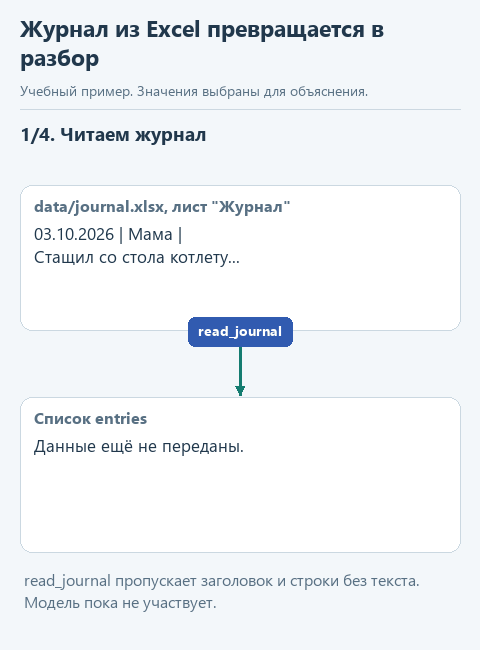
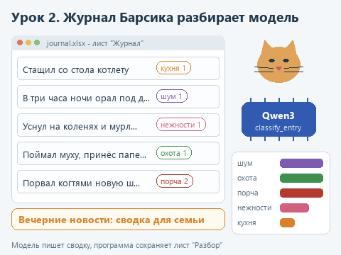

# Урок 2. Журнал проделок кота

[Исходники урока](../exercises/lesson-02-cat-journal/README.md) / [Подсказки рядом с кодом](../exercises/lesson-02-cat-journal/TASK.md)

> **Где мы.** Первое приложение с окном: утилита читает журнал из Excel, модель раскладывает записи по категориям и пишет сводку. Сегодня пишем функцию `classify_entry`, которая разбирает одну запись.
> **Из основного курса:** журнал как способ потом восстановить, что произошло; проверка на наборе контрольных примеров.
> **Новое:** окно на tkinter, чтение и запись Excel через openpyxl, классификация со списком допустимых категорий в схеме JSON.
> `Excel -> read_journal -> [classify_entry -> ask со схемой] -> категории -> сводка -> лист "Разбор"`

Представим семью, у которой живёт кот Барсик. Чтобы не спорить, кто виноват в разбитой чашке, семья завела в Excel журнал: дата, кто записал, что случилось. За неделю набралось двенадцать записей, от украденной котлеты до концерта в три часа ночи. Хочется понять, чем Барсик занимается чаще всего, и прочитать за ужином короткую сводку в духе вечерних новостей.

Задача шуточная, но устроена так же, как рабочая. Аналитики Авито из вводной разметили этим способом около 1 300 обращений в поддержку: каждой записи модель ставит категорию из заранее заданного списка, а люди потом смотрят на распределение и разбирают ошибки. На коте эту механику удобно потрогать руками: записей мало, все понятные, и ошибку модели вы заметите сразу.

## Откроем каркас

Скачайте [архив урока](../downloads/lesson-02-cat-journal.zip?raw=true), распакуйте и откройте папку `lesson-02-cat-journal` через **File -> Open**. Выберите общее окружение курса: щёлкните имя интерпретатора в правом нижнем углу окна PyCharm и выберите в списке `agent-venv`, а не `.venv` из папки урока, где нет библиотек курса. Если `agent-venv` в списке нет, выберите **Add New Interpreter -> Add Local Interpreter**, затем существующее окружение и путь `C:\Users\Имя\agent-venv\Scripts\python.exe`. Картинка с этим списком - в [первом уроке](01-model-in-process.md). Если в первом уроке вы не создавали окружение, потому что библиотека уже стояла в другом интерпретаторе, выберите его. В терминале PyCharm установите зависимости урока, к прежним добавится openpyxl:

```powershell
python -m pip install --only-binary=:all: -r requirements.txt
```

Модель уже скачана в первом уроке. Если вы начинаете курс отсюда, запустите `get_models.py`.

| Файл | Что в нём |
|---|---|
| `data/journal.xlsx` | Журнал: двенадцать записей о проделках Барсика |
| `journal_io.py` | Чтение и запись Excel, модель здесь не участвует |
| `journal_ai.py` | Категории, разбор записи моделью и сводка. Здесь пишем `classify_entry` |
| `app.py` | Окно утилиты |
| `demo_check.py` | Проверка вашей функции без модели |
| `demo.py` | Разбор журнала настоящей моделью в окне Run |

## Посмотрим на данные

Откройте `data/journal.xlsx` в Excel. На листе "Журнал" три столбца:

| Дата | Кто записал | Что случилось |
|---|---|---|
| 03.10.2026 | Мама | Стащил со стола котлету, пока все смотрели телевизор |
| 03.10.2026 | Папа | В три часа ночи орал под дверью спальни |
| 04.10.2026 | Бабушка | Уснул у меня на коленях и мурлыкал целый час |

Функция `read_journal` из `journal_io.py` открывает файл через библиотеку openpyxl, пропускает строку заголовка и для каждой строки с текстом создаёт словарь:

```python
{'date': '03.10.2026', 'author': 'Мама', 'text': 'Стащил со стола котлету, пока все смотрели телевизор'}
```

Если в ячейке даты стоит настоящая дата Excel, а не текст, openpyxl вернёт объект даты, и `as_text` превратит его в строку `'03.10.2026'`. Пустые строки журнала функция пропускает.

## Как устроена утилита

Код разложен по трём файлам по одному простому правилу: каждый файл знает только о своём. `journal_io.py` умеет читать и писать Excel, но ничего не знает про модель. `journal_ai.py` разбирает записи моделью и ничего не знает про окна. `app.py` рисует окно и по нажатию кнопок вызывает функции двух других файлов.

Благодаря этому вашу функцию можно проверить без окна и без модели, а окно можно перерисовать, не трогая разбор. Такое деление на слои мы подробнее разберём в пятом уроке, на веб-сервисе.

<details>
<summary>Почему окно не зависает, пока модель думает</summary>

Разбор двенадцати записей вместе со сводкой занял около двадцати секунд на компьютере, где проверялся курс, а на ноутбуке займёт дольше. Если вызвать его прямо из обработчика кнопки, окно перестанет откликаться: tkinter обрабатывает нажатия и перерисовку в том же потоке, где выполняется код. Поэтому `app.py` запускает разбор в отдельном потоке (`threading.Thread`), а тот складывает сообщения о ходе работы в очередь `queue.Queue`. Окно раз в 100 миллисекунд заглядывает в очередь через `window.after` и обновляет надпись и таблицу. Менять элементы окна из другого потока tkinter не разрешает, поэтому всё рисование происходит в основном потоке.

</details>



<details>
<summary>Статичный вариант</summary>



</details>

## Категории с пояснениями

Откройте `journal_ai.py`. Сверху словарь категорий:

```python
CATEGORIES = {
    'кухня': 'утащил или пытался утащить еду',
    'порча': 'испортил вещь: порвал, разбил, уронил, испачкал',
    'шум': 'мешал спать, громко орал, будил',
    'нежности': 'ласкался, мурлыкал, спал рядом',
    'охота': 'ловил насекомых, птиц, игрушки, гонялся за чем-то',
}
```

Из этого словаря собирается правило `CLASSIFY_RULE`: модель получает список категорий, каждую с коротким пояснением, и шкалу серьёзности от 1 до 3. Пояснения здесь не для красоты. При подготовке курса Qwen3-1.7B по одним названиям категорий правильно разложила пять записей из двенадцати, а с пояснениями - десять. Написать хорошие пояснения - это работа человека, который знает предмет; в рабочей задаче это обычно аналитик.

## Напишите сами

В `classify_entry` уже есть проверка на пустую запись. Замените строку `raise NotImplementedError(...)` фрагментом ниже и заполните два пропуска:

```python
    schema = {
        'type': 'object',
        'properties': {
            'category': {'type': 'string', 'enum': ...},
            'severity': {'type': 'integer', 'enum': [1, 2, 3]},
        },
        'required': ['category', 'severity'],
    }
    answer = ask(model, CLASSIFY_RULE, ..., schema=schema, max_tokens=64)
    return {'category': answer['category'], 'severity': answer['severity']}
```

1. В `'enum':` у категории поставьте `list(CATEGORIES)`. Список из словаря даёт его ключи: `['кухня', 'порча', 'шум', 'нежности', 'охота']`.
2. Третьим аргументом `ask` передайте `text` - текст записи.

Слово `enum` в схеме означает "одно из перечисленных значений". Модель не сможет написать категорию "еда" или "безобразие", даже если ей очень захочется: при выборе токенов допустимы только пять наших строк. То же для серьёзности: только 1, 2 или 3. Лимит `max_tokens=64` с запасом хватает на короткий JSON вида `{"category": "кухня", "severity": 1}`. Функция `ask` из первого урока вернёт его уже словарём, а мы возьмём из него два нужных поля.

## Угадайте до запуска

Перечитайте двенадцать записей журнала. Сколько из них модель разложит так же, как вы? Какие две-три записи кажутся вам спорными?

## Запустим

Откройте `demo_check.py` и выберите **Run 'demo_check'**. Подставная модель здесь отвечает по ключевому слову, а проверка смотрит, что вы передали модели текст записи и список категорий в схеме. После реализации:

```text
Проверка без модели: Стащил со стола котлету, пока все смотрели телевизор -> кухня, серьёзность 1
```

Теперь **Run 'demo'**. Программа загрузит модель и разберёт все записи. Так выглядел один из запусков при подготовке курса:

```text
    кухня | 1 | Стащил со стола котлету, пока все смотрели телевизор
      шум | 1 | В три часа ночи орал под дверью спальни
 нежности | 1 | Уснул у меня на коленях и мурлыкал целый час
    охота | 1 | Поймал муху и принёс её папе в тапок
    порча | 2 | Порвал когтями новую штору в гостиной
    ...
    охота | 2 | Прогрыз пакет с кормом и съел половину
      шум | 1 | Встречал меня у двери и тёрся о ноги
```

Под таблицей - подсчёт по категориям и сводка для семьи. Сводку пишет та же модель обычным текстом, без схемы, по правилу `SUMMARY_RULE`.

Наконец, откройте `app.py` и выберите **Run 'app'**. Появится окно. Нажмите **Открыть журнал**, выберите `data/journal.xlsx`, затем **Разобрать**. В строке состояния побегут номера записей, потом таблица заполнится категориями, а внизу появится сводка. Кнопка **Сохранить в Excel** добавит в файл лист "Разбор". Закройте файл в Excel перед сохранением, иначе Windows не даст его перезаписать.

## Проверьте результат

Сравните ответ модели со своей догадкой. В запуске выше две ошибки: корм модель отнесла к охоте, а встречу у двери - к шуму. Ваш запуск может отличаться: настройки выбора токенов допускают случайность.

Посмотрите на пояснения к категориям: про корм и про то, что кот трётся о ноги, в них ничего нет. Допишите в `CATEGORIES` к "кухне" слова "съел или испортил еду, в том числе свой корм", а к "нежностям" - "тёрся о ноги, встречал". При подготовке курса после такой правки модель дважды подряд разложила все двенадцать записей правильно.

Так и выглядит работа с классификацией на практике: прогнать набор записей с известным правильным ответом, найти ошибки, поправить описание категорий и прогнать снова. В основном курсе мы называли такой набор контрольными сценариями; для разметки обращений он нужен точно так же.

## Попробуйте сломать

**Уберите пояснения.** В `CLASSIFY_RULE` замените строку со списком категорий на `', '.join(CATEGORIES)`, чтобы модель видела только названия. Запустите `demo.py` и посчитайте ошибки. Верните как было.

**Уберите список из схемы.** Удалите `'enum': list(CATEGORIES)` у категории и запустите `demo.py`. При подготовке курса модель и без списка писала только названия из правила, но теперь это держится лишь на её поведении. Измените правило, возьмите другую модель - и в подсчёте рядом с "кухней" может появиться "еда", которую дальше никто не ждёт. Со списком в схеме недопустимое название не может появиться вовсе, поэтому верните `enum`.

**Добавьте пустую строку.** Вставьте в Excel строку, где заполнена только дата, сохраните и запустите `demo.py`. Запись не попадёт в разбор: `read_journal` пропускает строки без текста.

## Что мы получили

Утилита читает журнал из Excel, раскладывает записи по фиксированному списку категорий и сохраняет результат обратно в файл. Модель здесь отвечает за одно узкое действие, а правильность разметки проверяет человек по контрольным записям. Тот же журнал мы ещё встретим: в седьмом уроке Telegram-бот будет записывать в него новые проделки.

Дальше: [урок 3. Модель, которая принимает решения](03-decisions.md).
