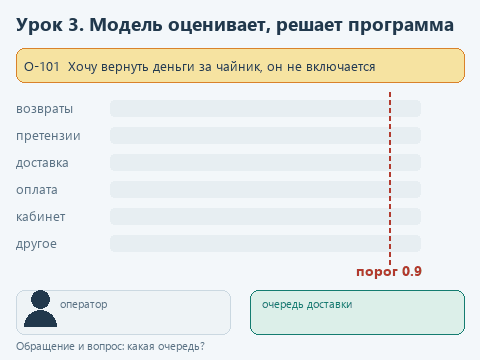
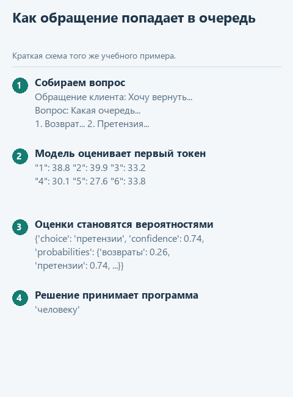

# Урок 3. Модель, которая принимает решения: Оценки уверенности и маршрутизация

[Исходники урока](../exercises/lesson-03-decisions/README.md) / [Подсказки рядом с кодом](../exercises/lesson-03-decisions/TASK.md)

> **Где мы находимся:** Во втором уроке модель выбирала категорию одним словом. 
> 
> Но по одному слову невозможно понять: была ли модель на 100% уверена или выбирала наугад между двумя похожими отделами? 
> 
> Сегодня мы научимся заглядывать во внутренние вероятности модели (logprobs) и создадим умный маршрутизатор обращений поддержки: уверенные запросы программа распределит автоматически, а сомнительные отдаст дежурному оператору:
> 
> `обращение клиента -> [модель решений] -> вероятности вариантов -> [программа: порог уверенности] -> очередь или человек`

---

## Проблема: почему обычный чат-бот не подходит для маршрутизации?

Представьте службу поддержки интернет-магазина. Ежедневно приходят сотни сообщений:
* "Курьер опоздал на два часа" (очередь "Доставка")
* "Списали деньги дважды за один заказ" (очередь "Оплата")
* "Хочу вернуть деньги за чайник, он не включается" (???)

Посмотрите на последнее обращение: клиент просит вернуть деньги (похоже на возврат), но причина - чайник не включается (а это технический брак, то есть претензия!).

Если спросить обычную языковую модель: "Какая это очередь?", она выдаст текст: "Возвраты" или "Претензии". Но вы никогда не узнаете, насколько она сомневалась. Если модель ошибется и молча отправит бракованный товар в обычный возврат, клиент потеряет две недели.

Для надежной автоматизации бизнесу нужно не просто мнение ИИ, а **числовая степень уверенности (confidence score)**:
* Уверенность 98% -> переводим автоматически без участия человека.
* Уверенность 65% -> модель сомневается; передаем заявку живому оператору для ручной проверки.

---

## Модели класса System One: когда нейросеть не пишет текст

В 2026 году компания TypeSafe AI представила концепцию моделей класса **System One** (на примере модели Jev), названную в честь "Системы 1" психолога Даниэля Канемана (быстрое интуитивное мышление без долгих рассуждений).

Такие модели вообще не генерируют длинный текст. Они принимают входящие данные и отвечают на закрытые вопросы:
1. **`choice` (выбор из списка):** выбрать один вариант и вернуть вероятности каждого.
2. **`noul` (да или нет):** оценить вероятность ответа "да" от 0.0 до 1.0.
3. **`score` (оценка по шкале):** оценить степень недовольства клиента от 0 до 5.

В этом уроке мы воспроизведем эту мощную архитектуру прямо на нашей локальной модели Qwen3-1.7B!

---

## Откуда берутся вероятности внутри языковой модели?

Когда модель генерирует ответ, она на каждом шаге вычисляет числовые оценки (логиты, logits) для всех 151 936 токенов своего словаря. Чем выше оценка токена, тем вероятнее модель выберет именно его.

В обычных чатах движок выбирает самый вероятный токен, а оценки выбрасывает. Но мы перехватим эти оценки!

Мы пронумеруем варианты цифрами 1, 2, 3, 4, 5, 6 и попросим модель ответить ровно одной цифрой:
1. Первый сгенерированный токен - это номер варианта.
2. Мы перехватываем оценки для токенов "1", "2", "3", "4", "5", "6".
3. С помощью математической функции **softmax** переводим эти оценки в строгие вероятности (числа от 0.0 до 1.0, сумма которых равна 1.0).
4. Процесс генерации останавливается ровно на 1 токене! Никаких лишних слов, мгновенный расчет за доли секунды.



<details>
<summary>Посмотреть схему работы с вероятностями (статичный вариант)</summary>



</details>

---

## Что находится в каркасе урока

1. Скачайте [архив урока](../downloads/lesson-03-decisions.zip?raw=true), откройте папку `lesson-03-decisions` в PyCharm.
2. Убедитесь, что выбрано окружение `agent-venv`. Новых библиотек устанавливать не требуется.

### Карта файлов проекта:
| Файл | За что отвечает |
|---|---|
| `data/requests.json` | 18 реальных обращений клиентов с эталонной разметкой операторов |
| `data/questions.json` | Вопросы для модели в формате System One / Jev |
| `decisions.py` | Вся логика: вычисление вероятностей, softmax и функция `ask_choice` |
| `demo_check.py` | Быстрая проверка функции без модели |
| `demo.py` | Боевой запуск маршрутизации всех 18 обращений с анализом точности |

---

## Напишите код сами

Откройте `decisions.py` и найдите функцию `ask_choice`:

```python
def ask_choice(model, state: str, question: dict) -> dict:
    names, options = zip(*question['criteria'].items())
    values = option_probabilities(model, state, question['instructions'], options)
    raise NotImplementedError('Допишите ask_choice по подсказкам урока')
```

В переменной `names` лежат названия очередей (`'возвраты'`, `'претензии'`, `'доставка'`, ...), а в `values` - вычисленные вероятности для каждого варианта.

Замените строчку `raise NotImplementedError(...)` следующим кодом и заполните три пропуска `...`:

```python
    probabilities = dict(zip(names, ...))
    choice = max(probabilities, key=...)
    return {
        'type': 'choice',
        'choice': choice,
        'confidence': probabilities[...],
        'probabilities': probabilities,
    }
```

1. В функции `zip` передайте вторым аргументом список вероятностей: `values`. Функция `dict(zip(...))` превратит их в аккуратный словарь: `{'возвраты': 0.12, 'претензии': 0.82, ...}`.
2. В параметре `key` укажите метод словаря: `probabilities.get`. Функция `max` сравнит варианты по их вероятностям и вернет название очереди с наибольшим значением. *(Внимание: пишите именно `probabilities.get` без скобок, так как функцию вызовет сама `max`).*
3. В поле `confidence` ("уверенность") положите вероятность выбранного победителя: `probabilities[choice]`.

---

## Запустим и проверим

### 1. Быстрый тест без модели
Запустите `demo_check.py` (**Run 'demo_check'**):
```text
Проверка без модели: Списали деньги дважды за один заказ -> оплата, уверенность 0.97
```

### 2. Запуск классификации на всех 18 обращениях
Запустите `demo.py` (**Run 'demo'**).
Программа прогонит все заявки через модель и выдаст красивый отчет:

```text
О-101 человеку  претензии 0.74         Хочу вернуть деньги за чайник, он не включается
О-102 претензии претензии 1.00         Чайник сломался через неделю, верните оплату
О-103 возвраты  возвраты  1.00         Как сдать обратно куртку? Не подошёл размер
О-104 доставка  доставка  1.00         Курьер опоздал на три часа
...
О-117 доставка  доставка  1.00         Курьер опоздал на два часа, а кружка внутри оказалась разбитой
О-118 человеку  другое    0.98         Здравствуйте, у вас есть подарочные сертификаты?

Порог 0.9. Разложено программой: 16, совпало с разметкой: 15. Человеку: 2.
  Расхождение: О-117 -> доставка с уверенностью 1.00, по разметке претензии
В среднем 0.9 с на обращение
```

### Разбор результатов:
* **Обращение О-101:** Модель сомневалась между возвратом и поломкой (уверенность всего 0.74). Программа увидела, что уверенность ниже порога 0.90, и передала заявку **человеку**! Никаких ошибок для клиента.
* **Обращение О-118 (сертификаты):** Ни одна стандартная очередь не подошла, модель выбрала "другое", и заявка ушла оператору.
* **Обращение О-117:** Модель уверенно выбрала "доставку" из-за слов про курьера, не заметив разбитую кружку. 

---

## Архитектурный прием: Соединяем два простых вопроса вместо одного сложного

Как исправить ошибку с разбитой кружкой в заявке О-117?
Вместо того чтобы усложнять промпт, мы зададим модели **второй независимый вопрос**: *"Товар поврежден или сломан? (да / нет)"*.

1. Откройте `data/questions.json` и добавьте второй вопрос `damaged`:
```json
  "damaged": {
    "type": "noul",
    "instructions": "Товар пришёл повреждённым или сломанным?"
  }
```

2. В файле `decisions.py` в функции `route` добавьте бизнес-правило:
```python
    if queue['choice'] == 'доставка' and answers['damaged']['noul'] >= 0.5:
        return 'претензии'
```

3. Запустите `demo.py` снова: теперь заявка О-117 автоматически перенаправляется в претензии, и точность программы достигает **100% (16 из 16)**!

---

## Под капотом: как устроен проект урока и ключевые модули

Модуль `decisions.py` реализует фундаментальный паттерн работы с логитами нейросетей.

### Карта вызовов:
```text
demo.py
  └── decide(model, requests, questions)
        └── ask_choice(model, request, question)
              └── option_probabilities(...) -> вызов model.create_completion(max_tokens=1)
  └── route(answers, threshold=0.9) -> бизнес-логика маршрутизации
```

> 💡 **Для тех, кто хочет вникнуть глубже:** Полный построчный разбор всех формул, логитов, функции softmax и кода модуля `decisions.py` доступен в отдельном руководстве: [Дополнительно: Как устроен decisions.py](03-decisions-module.md).

---

## Итог урока

* Мы освоили модели класса System One: быстрые решения с оценкой вероятности вместо медленной генерации текста.
* Научились извлекать вероятности токенов (logprobs) и переводить их в проценты через softmax.
* Реализовали разделение потока: автоматическая обработка при высокой уверенности и эскалация на человека при сомнениях.
* Поняли, что декомпозиция на несколько простых вопросов работает точнее, чем один перегруженный промпт.

---

## Что дальше

До сих пор наши модели работали только с текстом. В следующем уроке мы дадим ИИ "глаза": подключим мультимодальную модель Qwen3-VL и научим её анализировать реальные фотографии товаров из заявок на возврат!

-> [Урок 4. Модель зрения проверяет фото товара](04-vision.md)
