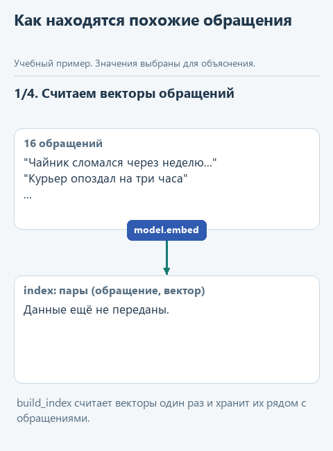
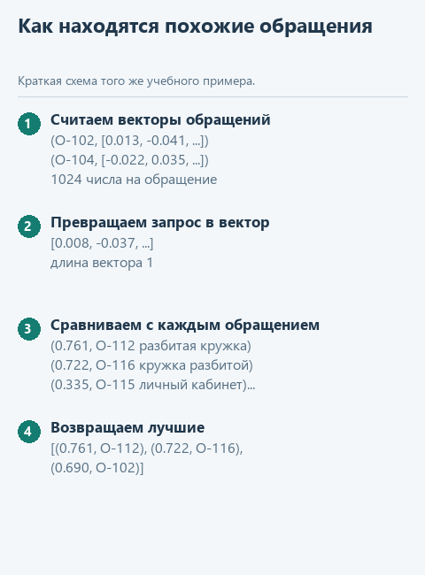

# Урок 3. Модель, которая каталогизирует

[Исходники урока](../exercises/lesson-03-embeddings/README.md) / [Подсказки рядом с кодом](../exercises/lesson-03-embeddings/TASK.md)

> **Где мы.** Знакомимся с моделью, которая не пишет текст, а превращает его в числа. По этим числам программа находит обращения клиентов о той же проблеме. Сегодня пишем функцию `find_similar`.
> **Из основного курса:** поиск `find_notes`, который находил пункты регламента по подстроке, и идея передать модели только найденные пункты.
> **Новое:** эмбеддинги, косинусная близость, поиск по смыслу и группировка дублей.
> `обращения -> [модель эмбеддингов] -> векторы; запрос -> вектор -> близость -> похожие обращения`

Вернёмся в поддержку интернет-магазина из основного курса. За неделю пришло шестнадцать обращений: сломанный чайник, опоздавший курьер, двойное списание денег, куртка не того размера. В настоящей поддержке их тысячи, и аналитику нужно ответить на два вопроса: какие обращения про одну и ту же проблему и какая проблема встречается чаще всего.

В первом уроке основного курса мы искали по подстроке: функция `find_notes` находила "Возврат товара возможен..." по запросу "возврат". Попробуйте найти так обращения о сломанном товаре. По слову "сломан" не найдётся ничего: клиенты пишут "сломался", "разбитая", "не включается". Слова разные, а проблема одна.

## Модель, которая раскладывает по полкам

Модель эмбеддингов получает текст и возвращает не ответ, а список чисел - вектор. У модели этого урока в векторе 1024 числа. Обучена она так, что тексты, близкие по смыслу, получают близкие векторы. "Чайник сломался через неделю" и "Хочу вернуть деньги за чайник, он не включается" окажутся рядом, а "Курьер опоздал на три часа" - далеко от них.

Близость двух векторов удобно мерить косинусом угла между ними: 1 - направлены одинаково, около 0 - не связаны. Если заранее привести каждый вектор к длине 1, косинус считается совсем просто: перемножить числа попарно и сложить. Для двух коротких векторов `[0.6, 0.8]` и `[0.8, 0.6]` это `0.6 * 0.8 + 0.8 * 0.6 = 0.96` - очень близко.

Эмбеддинги - основа поиска в системах RAG: программа находит фрагменты документов, близкие к вопросу, и передаёт их языковой модели. В основном курсе этот шаг выполнял `find_notes`, а с эмбеддингами он начнёт понимать и "вернуть деньги", и "сдать обратно".

Возьмём Qwen3-Embedding-0.6B из [официального репозитория Qwen](https://huggingface.co/Qwen/Qwen3-Embedding-0.6B-GGUF): файл около 640 МБ, понимает русский, работает через ту же библиотеку `llama-cpp-python`. При подготовке курса шестнадцать обращений она превратила в векторы меньше чем за секунду.

<details>
<summary>Модели, которые предсказывают смысл, а не слова: JEPA</summary>

В разговорах о моделях "не для чата" часто упоминают JEPA - Joint Embedding Predictive Architecture. Идею продвигает Ян Лекун и команда Meta: модель учится предсказывать не следующее слово или пиксель, а вектор-смысл недостающей части. В декабре 2025 года вышла статья о [VL-JEPA](https://arxiv.org/abs/2512.10942): модель для картинок и текста предсказывает эмбеддинг ответа, а текст из него получает отдельный небольшой декодер, и только когда это нужно. Классификация и поиск у такой модели работают прямо в пространстве векторов.

Открытые веса моделей этого семейства есть, например [I-JEPA](https://huggingface.co/facebook/ijepa_vith14_1k) для изображений и [V-JEPA 2](https://huggingface.co/facebook/vjepa2-vitl-fpc64-256) для видео. Они требуют PyTorch и для ноутбука без видеокарты тяжеловаты, поэтому в курсе мы берём Qwen3-Embedding. Принцип тот же, что у JEPA: вместо текста модель выдаёт вектор, и программа сравнивает смыслы как числа.

</details>

## Откроем каркас

Скачайте [архив урока](../downloads/lesson-03-embeddings.zip?raw=true), откройте папку `lesson-03-embeddings` в PyCharm и выберите общее окружение курса, как в прошлом уроке. Новых библиотек не нужно. Запустите `get_models.py`: он скачает `Qwen3-Embedding-0.6B-Q8_0.gguf` в общую папку моделей.

| Файл | Что в нём |
|---|---|
| `data/requests.json` | Шестнадцать обращений клиентов |
| `similar.py` | Векторы, близость, поиск и группировка. Здесь пишем `find_similar` |
| `demo_check.py` | Проверка функции на подставной модели |
| `demo.py` | Поиск и группировка настоящей моделью |

## Посмотрим на данные

Каждое обращение в `data/requests.json` - словарь с номером и текстом:

```python
{'id': 'О-112', 'text': 'Коробка пришла мятая, внутри разбитая кружка'}
```

В `similar.py` уже готовы четыре функции. `embed_text` просит модель превратить текст в вектор (метод `model.embed`) и делит каждое число на длину вектора, чтобы длина стала равна 1. `cosine` перемножает два вектора попарно и складывает. `build_index` один раз считает векторы всех обращений и хранит их парами `(обращение, вектор)`: пересчитывать их при каждом запросе незачем. `group_duplicates` раскладывает обращения по группам, если близость выше порога.

Перед текстом `embed_text` ставит строку `TASK`: "Instruct: Найди обращения клиентов о той же проблеме". Qwen3-Embedding обучали с такими пояснениями, и они подсказывают модели, какая похожесть нас интересует: по проблеме клиента, а не, например, по стилю письма.

## Напишите сами

`find_similar` получает модель, текст запроса, готовый индекс и число `top` - сколько обращений вернуть. Замените строку `raise NotImplementedError(...)` фрагментом ниже и заполните три пропуска:

```python
    query_vector = embed_text(model, ...)
    scored = []
    for record, vector in index:
        scored.append((cosine(..., vector), record))
    scored.sort(key=lambda pair: pair[0], reverse=True)
    return scored[:...]
```

1. В `embed_text` передайте `query`: запрос превращается в вектор тем же способом, что и обращения.
2. Первым аргументом `cosine` поставьте `query_vector`.
3. В срезе поставьте `top`.

Цикл проходит по парам индекса и для каждого обращения складывает в список `scored` пару `(близость, обращение)`. Метод `sort` с `key=lambda pair: pair[0]` сортирует пары по первому элементу - по близости, а `reverse=True` ставит самые близкие первыми. Срез `scored[:top]` оставляет первые `top` пар. Без `key` Python попробовал бы при равной близости сравнивать сами словари обращений и выдал бы ошибку.

## Угадайте до запуска

Запрос в `demo.py` - "товар пришёл сломанным". Какие три обращения окажутся ближе всего? И что найдёт старый поиск по слову "сломан"?

## Запустим

Откройте `demo_check.py` и выберите **Run 'demo_check'**. Подставная модель строит векторы из пяти чисел по заранее выбранным словам, поэтому результат всегда одинаковый:

```text
Проверка без модели: Хочу вернуть деньги за чайник, он не включается
```

Теперь **Run 'demo'**. При подготовке курса вывод был таким:

```text
Поиск по слову "сломан": []
Длина вектора: 1024
0.761 О-112 Коробка пришла мятая, внутри разбитая кружка
0.722 О-116 Кружка приехала разбитой, хочу замену
0.690 О-102 Чайник сломался через неделю, верните оплату
Группы похожих обращений:
  Хочу вернуть деньги за чайник, он не включается | Чайник сломался через неделю, верните оплату
  Как сдать обратно куртку? Не подошёл размер | Можно ли обменять кроссовки на размер больше?
  Курьер опоздал на три часа | Заказ привезли на день позже обещанного | Доставка не пришла в назначенное время
  Списали деньги дважды за один заказ | Оплата прошла два раза, верните лишнее
  Коробка пришла мятая, внутри разбитая кружка | Кружка приехала разбитой, хочу замену
```

Поиск по слову не нашёл ничего, поиск по смыслу - три обращения о повреждённом товаре. Группы показывают картину недели: больше всего жалоб на доставку. Числа близости у вас могут чуть отличаться, а состав групп должен совпасть.

## Попробуйте сломать

**Уберите пояснение задачи.** В `similar.py` замените значение `TASK` на пустую строку `''` и запустите `demo.py`. При подготовке курса группировка с тем же порогом 0.7 нашла после этого только одну группу - про двойное списание. Пояснение меняет, какие тексты модель считает похожими. Верните `TASK`.

**Сдвиньте порог.** В `demo.py` вызовите `group_duplicates(index, 0.6)`. Группы станут крупнее: при подготовке курса к обращениям о куртке и кроссовках присоединился общий вопрос "Как оформить возврат товара?". Нужен ли он в этой группе, зависит от того, что вы считаете одной проблемой. Порог - решение аналитика, и подбирают его на примерах, где правильная группировка известна заранее. Верните вызов без порога.

**Спросите о деньгах.** Замените `QUERY` в `demo_check.py` на "хочу сдать товар и получить деньги назад". Первым при подготовке курса оказалось обращение "Оплата прошла два раза, верните лишнее": по смыслу рядом, речь о возврате денег, но проблема другая. Близость векторов - подсказка, а решение, одна ли это проблема, принимает человек.

## Что мы получили

Модель эмбеддингов не пишет ни слова, но раскладывает тексты по смыслу, и программа находит похожие обращения, даже когда в них нет общих слов. Порог и пояснение задачи определяют, что считать похожим, и подбираются на проверенных примерах. В пятом уроке эта же модель станет поиском в веб-сервисе.



<details>
<summary>Статичный вариант</summary>



</details>

Дальше: [урок 4. Модель зрения проверяет фото](04-vision.md).
