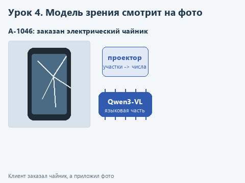
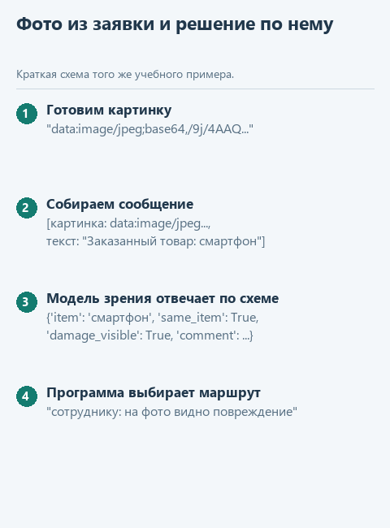

# Урок 4. Модель зрения проверяет фото

[Исходники урока](../exercises/lesson-04-vision/README.md) / [Подсказки рядом с кодом](../exercises/lesson-04-vision/TASK.md)

> **Где мы.** Модель впервые получает не текст, а фотографию. Она смотрит на фото из заявки на возврат, а программа по её ответу решает, куда направить заявку. Сегодня пишем функцию `check_photo`.
> **Из основного курса:** регламент возвратов, согласие человека перед действием из урока о применении правки, схема JSON из первого урока этой ступени.
> **Новое:** модель зрения из двух файлов, картинка внутри сообщения, порядок полей в схеме.
> `заявка + фото -> [check_photo: картинка + название товара -> модель зрения] -> {item, same_item, damage_visible} -> route_return -> сотрудник`

К заявке на возврат клиент прикладывает фотографию товара. Сотрудник магазина раскладывает такие заявки: если на фото не тот товар, нужно попросить другое фото; если видно повреждение, заявку стоит рассмотреть первой; если повреждения на фото не видно, товар придётся проверить, когда его привезут. Первую сортировку может сделать модель, а решение о возврате денег остаётся за сотрудником - как в основном курсе правку кода применяли только после согласия человека.

Похожую схему описывает Дмитрий Колесников из Wildberries в [статье о модерации карточек товаров](https://habr.com/ru/articles/992716): модель зрения, которая понимает и текст, получает фото и вопрос о нарушении и отвечает "да" или "нет". Её запускают не на весь поток, а только на изображения, которые раньше отметила основная модель, чтобы снизить число ложных срабатываний и разгрузить ручную модерацию.

## Модель зрения из двух файлов

Языковая модель из прошлых уроков понимает только текст. Прежде чем что-то посчитать, она переводит каждое слово в набор чисел и дальше работает уже с ними. Чтобы она увидела фотографию, картинку тоже нужно перевести в такие числа. Этим занята отдельная часть модели - проектор, поэтому модель зрения поставляется двумя файлами.

Возьмём Qwen3-VL-2B из [официального репозитория Qwen](https://huggingface.co/Qwen/Qwen3-VL-2B-Instruct-GGUF). Языковая часть `Qwen3VL-2B-Instruct-Q4_K_M.gguf` (около 1,1 ГБ) пишет ответ, как Qwen3 из прошлых уроков. Проектор `mmproj-Qwen3VL-2B-Instruct-Q8_0.gguf` (около 450 МБ) разбивает картинку на небольшие участки и каждый переводит в числа, которые языковая часть читает так же, как слова. Загружает оба файла вместе функция `load_vision` из `local_llm.py`.

Перед выбором мы проверили и модель поменьше, SmolVLM2-500M: на тех же фото она путалась в предметах и повторяла одну фразу до лимита длины. Qwen3-VL-2B на компьютере, где проверялся курс, разбирала одно фото за 5-12 секунд и правильно ответила на все пять заявок этого урока.



<details>
<summary>Статичный вариант</summary>



</details>

## Откроем каркас

Скачайте [архив урока](../downloads/lesson-04-vision.zip?raw=true), откройте папку `lesson-04-vision` в PyCharm и выберите общее окружение курса: щёлкните имя интерпретатора в правом нижнем углу окна PyCharm и выберите в списке `agent-venv`, а не `.venv` из папки урока, где нет библиотек курса. Запустите `get_models.py`: он скачает два файла модели, около 1,6 ГБ.

| Файл | Что в нём |
|---|---|
| `data/returns.json` | Пять заявок: номер заказа, товар, причина возврата, имя файла фото |
| `data/photos` | Четыре фотографии; откуда они, записано в `SOURCES.md` |
| `photo_check.py` | Правило, схема, подготовка фото и маршрут заявки. Здесь пишем `check_photo` |
| `demo_check.py` | Проверка функции на подставной модели |
| `demo.py` | Разбор всех заявок настоящей моделью |

## Посмотрим на данные

Заявка выглядит так:

```python
{'order': 'А-1044', 'item': 'кроссовки', 'reason': 'не подошёл размер', 'photo': 'mug.jpg'}
```

В этой заявке клиент заказал кроссовки, а приложил фото кружки. Такие ошибки и должна ловить проверка. В последней заявке, А-1046, к чайнику приложено фото разбитого смартфона.

Сообщение для модели зрения устроено чуть иначе, чем в прошлых уроках. Содержимое сообщения `user` - не строка, а список из двух частей: картинки и текста.

```python
{'role': 'user', 'content': [
    {'type': 'image_url', 'image_url': {'url': 'data:image/jpeg;base64,/9j/4AAQSkZJRg...'}},
    {'type': 'text', 'text': 'Заказанный товар: кроссовки'},
]}
```

Картинку мы передаём прямо внутри сообщения. Готовая функция `image_to_data_uri` читает байты файла и записывает их текстом в кодировке base64, а приставка `data:image/jpeg;base64,` сообщает, что внутри картинка JPEG. Файл никуда не загружается: строка целиком остаётся в памяти программы.

Ответ модели ограничивает схема `PHOTO_SCHEMA` с четырьмя полями: `item` - что на фото, `same_item` - тот же ли это товар, `damage_visible` - видно ли повреждение, `comment` - короткое пояснение для сотрудника. Поля типа `boolean` принимают только `true` или `false`, поэтому программе не нужно гадать, что значит "скорее да". У строк задана наибольшая длина `maxLength`, чтобы модель не писала сочинение и не упиралась в лимит.

## Напишите сами

Замените в `check_photo` строку `raise NotImplementedError(...)` фрагментом ниже и заполните два пропуска:

```python
    messages = [
        {'role': 'system', 'content': PHOTO_RULE},
        {'role': 'user', 'content': [
            {'type': 'image_url', 'image_url': {'url': image_to_data_uri(...)}},
            {'type': 'text', 'text': 'Заказанный товар: ' + ...},
        ]},
    ]
    response = model.create_chat_completion(
        messages=messages, max_tokens=200, temperature=0.2,
        response_format={'type': 'json_object', 'schema': PHOTO_SCHEMA},
    )
    return json.loads(clean_answer(response))
```

1. В `image_to_data_uri` передайте `photo` - путь к файлу фото.
2. После строки "Заказанный товар: " допишите `ordered_item` - название товара из заявки.

Здесь мы вызываем модель напрямую, без `ask`: функция `ask` из первого урока собирает сообщение `user` из строки, а нам нужен список из картинки и текста. Разбор ответа тот же - `clean_answer` и `json.loads`. Низкая `temperature=0.2` уменьшает случайность выбора токенов: для проверки нам нужен устойчивый ответ, а не разнообразие формулировок.

## Угадайте до запуска

Посмотрите на пять заявок в `data/returns.json` и фото в `data/photos`. Куда функция `route_return` направит каждую заявку? Для какой из них фото вообще не может подтвердить причину возврата?

## Запустим

Откройте `demo_check.py` и выберите **Run 'demo_check'**. Подставная модель всегда отвечает, что на фото разбитый смартфон. Проверка смотрит, что в сообщении сначала идёт картинка в виде `data:image/jpeg;base64,...`, затем название товара. После реализации:

```text
Проверка без модели: сотруднику: на фото видно повреждение
```

Теперь **Run 'demo'**. Загрузка двух файлов займёт несколько секунд, потом по каждой заявке появятся ответ модели и решение. Так выглядел запуск при подготовке курса, комментарии сокращены:

```text
А-1042: электрический чайник, причина "не включается", фото kettle.jpg
  Модель: {'item': 'электрический чайник', 'same_item': True, 'damage_visible': False, ...}
  Решение: сотруднику: на фото повреждений не видно, нужна проверка товара (7 сек)
А-1044: кроссовки, причина "не подошёл размер", фото mug.jpg
  Модель: {'item': 'миска с пузырьками', 'same_item': False, 'damage_visible': False,
           'comment': 'Смартфон с визуальным эффектом, изображающим молнии и свет.'}
  Решение: попросить другое фото: на снимке не заказанный товар (8 сек)
А-1046: электрический чайник, причина "пришёл разбитым", фото phone.jpg
  Модель: {'item': 'смартфон', 'same_item': False, 'damage_visible': True, ...}
  Решение: попросить другое фото: на снимке не заказанный товар (6 сек)
```

Все пять решений оказались верными. Посмотрите на заявку А-1044: пар над кружкой модель назвала "миской с пузырьками", а в комментарии и вовсе написала про смартфон. Решение при этом правильное, потому что `route_return` смотрит только на поля `same_item` и `damage_visible`, а комментарий читает человек. Свободный текст маленькой модели - подсказка сотруднику, решения на нём не строят.

Заявка А-1042 показывает границу метода: чайник "не включается", а этого на фото не видно никогда. Модель ответила, что повреждений не видно, и заявка ушла на проверку товара.

## Попробуйте сломать

**Верните первую версию.** При подготовке курса правило сначала было короче, а поля `item` в схеме не было. В `PHOTO_SCHEMA` удалите строку с `'item'` и `'item'` из списка `required`, а в `PHOTO_RULE` замените всё, что стоит до слов "В comment", таким текстом: "Ты помогаешь проверять фото товаров по заявкам на возврат. Сравни предмет на фото с заказанным товаром и скажи, видны ли повреждения: трещины, сколы, разбитое стекло, вмятины." Запустите `demo.py` и посмотрите на заявку А-1046. С этой версией модель ответила, что разбитый смартфон - это заказанный электрический чайник (`same_item: True`). Модель заполняет поля по порядку, и когда она сначала называет предмет, сравнение с заказом получается точнее. Верните правило и поле `item` на первое место.

**Снимите ограничение длины.** Удалите `'maxLength': 200` у комментария, а последнее предложение правила замените на "Отвечай по-русски.". В первой версии правила, где ограничений длины не было, модель расписала комментарий к фото кроссовок на все 200 токенов, и `clean_answer` сообщил `Генерация не завершена`. Посмотрите, как поведёт себя модель у вас, и верните ограничение.

**Подсуньте своё фото.** Сфотографируйте любой предмет дома, сохраните как JPEG в `data/photos` и добавьте заявку в `returns.json`. Проверьте, справится ли модель с вашим светом и фоном.

## Что мы получили

Модель зрения разложила заявки по трём направлениям, а решение о деньгах осталось за сотрудником. Программа опирается только на поля с ответом "да" или "нет", порядок полей в схеме помогает модели сначала разглядеть предмет, а потом сравнить, и свободный текст модели идёт человеку как подсказка.

Дальше: [урок 5. Модель в веб-сервисе](05-movie-service.md).
