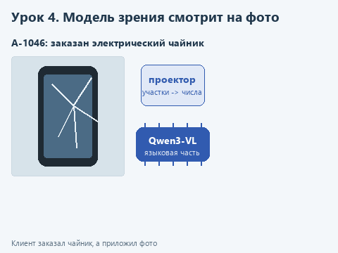
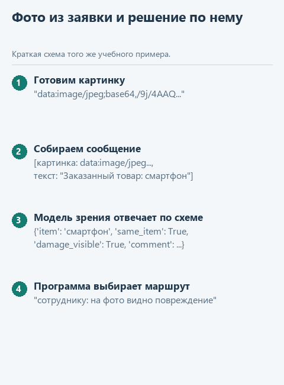

# Урок 4. Модель зрения проверяет фото товара (Multimodal Vision)

[Исходники урока](../exercises/lesson-04-vision/README.md) / [Подсказки рядом с кодом](../exercises/lesson-04-vision/TASK.md)

> **Где мы находимся:** Наша локальная модель впервые получает не текст, а реальную фотографию! 
> 
> Мы подключаем мультимодальную модель зрения Qwen3-VL, передаем ей снимок товара из клиентской заявки на возврат и классифицируем обращение:
> 
> `Заявка клиента + фото -> [check_photo: проектор + языковая модель] -> {item, same_item, damage_visible} -> маршрут -> сотрудник`

---

## В чем бизнес-задача?

Когда покупатель оформляет заявку на возврат бракованного товара в интернет-магазине, он прикрепляет фотографию. 

Сотруднику службы поддержки приходится вручную отсматривать тысячи однотипных снимков:
1. **На фото не тот товар:** Заказали кроссовки, а приложили фото кружки или кота. Нужно вежливо попросить покупателя загрузить правильный снимок.
2. **На фото явно виден дефект:** Разбитый экран смартфона, скол на посуде, оторванная ручка. Такую заявку нужно одобрить в приоритетном порядке.
3. **Дефекта на фото не видно:** Например, чайник "не включается". По фотографии невозможно проверить работу нагревательного элемента - товар придется проверить на складе после поступления.

Первичную сортировку изображений может взять на себя локальная модель зрения. При этом критическое финансовое решение о возврате денег остается за живым человеком - ровно так же, как в первой ступени кодирующий агент применял изменения только с явного согласия разработчика (Human-in-the-loop).

Похожую систему модерации карточек товаров использует Wildberries: мультимодальная нейросеть отсеивает явный мусор и разгружает команду ручной проверки.

---

## Как устроена модель зрения: зачем нужны два файла?

Обычная языковая модель понимает только текст: она преобразует слова в числовые векторы. Картинку (набор цветных пикселей) она прочитать не может.

Чтобы модель научилась "видеть", архитектура делится на две части:
1. **Визуальный проектор (`mmproj`):** отдельный нейросетевой блок. Он нарезает изображение на небольшие кусочки (патчи) и превращает визуальные образы в числовые векторы ровно того же формата, что и текстовые слова.
2. **Языковая модель:** получает эти визуальные токены вместе с текстовым вопросом и формулирует ответ.

Именно поэтому модель зрения поставляется в виде двух файлов:
* `Qwen3VL-2B-Instruct-Q4_K_M.gguf` (около 1.1 ГБ) - языковое ядро.
* `mmproj-Qwen3VL-2B-Instruct-Q8_0.gguf` (около 450 МБ) - визуальный проектор.

Функция `load_vision()` из нашего модуля `local_llm.py` автоматически соединяет оба файла в единый рабочий конвейер прямо на процессоре вашего ноутбука.



<details>
<summary>Посмотреть схему работы с изображениями (статичный вариант)</summary>



</details>

---

## Что находится в каркасе урока

1. Скачайте [архив урока](../downloads/lesson-04-vision.zip?raw=true), откройте папку `lesson-04-vision` в PyCharm.
2. Убедитесь, что выбрано окружение `agent-venv`.
3. Запустите `get_models.py`: скрипт скачает файлы модели зрения (около 1.6 ГБ в сумме) в общую папку моделей.

### Карта файлов проекта:
| Файл | За что отвечает |
|---|---|
| `data/returns.json` | 5 заявок на возврат: номер заказа, товар, причина и имя файла фото |
| `data/photos/` | Реальные фотографии товаров из заявок (чайник, кроссовки, кружка, разбитый телефон) |
| `photo_check.py` | Вся логика: кодирование фото в base64, схема ответа и функция `check_photo` |
| `demo_check.py` | Быстрый тест без загрузки модели зрения |
| `demo.py` | Полная обработка всех 5 заявок с анализом фото на CPU |

---

## Как передать картинку в модель?

В коде `photo_check.py` сообщение для модели формируется не как обычная строка, а как составной список:

```python
{
    'role': 'user',
    'content': [
        {
            'type': 'image_url',
            'image_url': {'url': 'data:image/jpeg;base64,/9j/4AAQSkZJRg...'}
        },
        {
            'type': 'text',
            'text': 'Заказанный товар: кроссовки'
        }
    ]
}
```

Готовая функция `image_to_data_uri(photo_path)` считывает байты локального JPEG-файла и переводит их в текстовую строку Base64. Никаких внешних серверов и хостингов картинок: изображение остается в оперативной памяти вашего процесса.

### Схема ответа: хитрость с порядком полей
Ответ модели ограничивается схемой `PHOTO_SCHEMA`:
* `item` (строка) - что именно изображено на фото.
* `same_item` (boolean, `true`/`false`) - совпадает ли предмет с заказом.
* `damage_visible` (boolean, `true`/`false`) - видны ли физические повреждения.
* `comment` (строка, до 200 символов) - короткий комментарий для оператора.

**Важный секрет:** поле `item` стоит в схеме **первым не случайно**!
Поскольку модель генерирует ответ слева направо, порядок полей заставляет её сначала осознать и назвать предмет ("кружка"), и только после этого ответить на вопрос `same_item` ("это кроссовки? -> false"). Это драматически повышает точность логических выводов.

---

## Напишите код сами

В файле `photo_check.py` найдите функцию `check_photo`:

```python
def check_photo(model, photo: Path, ordered_item: str) -> dict:
    raise NotImplementedError('Допишите check_photo по подсказкам урока')
```

Замените строчку `raise NotImplementedError(...)` следующим кодом и заполните два пропуска `...`:

```python
    messages = [
        {'role': 'system', 'content': PHOTO_RULE},
        {'role': 'user', 'content': [
            {'type': 'image_url', 'image_url': {'url': image_to_data_uri(...)}},
            {'type': 'text', 'text': 'Заказанный товар: ' + ...},
        ]},
    ]
    response = model.create_chat_completion(
        messages=messages,
        max_tokens=200,
        temperature=0.2,
        response_format={'type': 'json_object', 'schema': PHOTO_SCHEMA},
    )
    return json.loads(clean_answer(response))
```

1. В `image_to_data_uri` передайте путь к файлу фотографии: `photo`.
2. После строки `'Заказанный товар: '` подставьте переменную с названием товара: `ordered_item`.

---

## Запустим и проверим

### 1. Быстрый тест без модели
Запустите `demo_check.py` (**Run 'demo_check'**):
```text
Проверка без модели: сотруднику: на фото видно повреждение
```

### 2. Реальный анализ фото на CPU
Запустите `demo.py` (**Run 'demo'**).
Движок загрузит языковое ядро и проектор и разберет все пять заявок (в среднем 6-10 секунд на фотографию на стандартном процессоре):

```text
А-1042: электрический чайник, причина "не включается", фото kettle.jpg
  Модель: {'item': 'электрический чайник', 'same_item': True, 'damage_visible': False, ...}
  Решение: сотруднику: на фото повреждений не видно, нужна проверка товара (7 сек)

А-1044: кроссовки, причина "не подошёл размер", фото mug.jpg
  Модель: {'item': 'миска с пузырьками', 'same_item': False, 'damage_visible': False, ...}
  Решение: попросить другое фото: на снимке не заказанный товар (8 сек)

А-1046: электрический чайник, причина "пришёл разбитым", фото phone.jpg
  Модель: {'item': 'смартфон', 'same_item': False, 'damage_visible': True, ...}
  Решение: попросить другое фото: на снимке не заказанный товар (6 сек)
```

Посмотрите, как четко сработали бизнес-правила:
* В заявке А-1044 вместо кроссовок загрузили кружку -> программа автоматически формирует статус *"попросить другое фото"*.
* В заявке А-1046 на чайник приложили разбитый телефон -> несмотря на явные трещины на экране, программа видит, что это не чайник, и не одобряет возврат ошибочно!
* В заявке А-1042 чайник целый (он не включается) -> программа отправляет товар на физическую диагностику на складе.

---

## Итог урока

* Мы освоили мультимодальные модели (Vision Language Models) прямо на домашнем процессоре.
* Поняли, как работает визуальный проектор (`mmproj`), переводящий пиксели в токены для LLM.
* Научились передавать локальные изображения через Base64 Data URI.
* Использовали порядок полей в схеме JSON для повышения точности логических рассуждений.

---

## Что дальше

Мы научили локальный ИИ читать текст, принимать решения и смотреть на фото. Но до сих пор весь код запускался как разовые скрипты.

В следующем уроке мы превратим нашу модель в настоящий **веб-сервис на Flask**: подключим модель векторных эмбеддингов и создадим умный семантический поиск "по смыслу", доступный прямо через браузер!

-> [Урок 5. Модель в веб-сервисе: Эмбеддинги и семантический поиск](05-movie-service.md)
