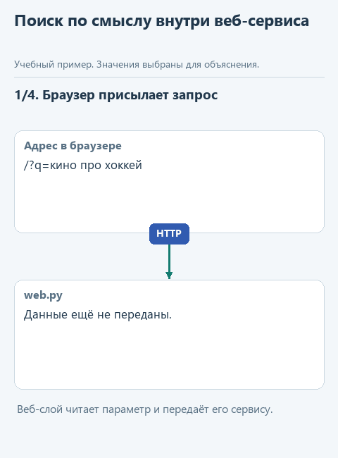
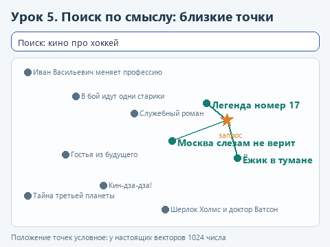

# Урок 5. Модель в веб-сервисе

[Исходники урока](../exercises/lesson-05-movie-service/README.md) / [Подсказки рядом с кодом](../exercises/lesson-05-movie-service/TASK.md)

> **Где мы.** Берём готовый локальный веб-сервис - каталог фильмов - и встраиваем в него модель. Сегодня пишем метод `SemanticSearch.find` и подключаем его в точке сборки `run.py`.
> **Из основного курса:** готовые адаптеры подключения к разным сервисам моделей, граница возможностей в `dispatch_tool`. Из этой ступени - загрузка модели в программу из урока 1 и общий формат ответов из урока 3, одинаковый для локальной модели и Jev.
> **Новое:** модель эмбеддингов и поиск по смыслу, веб-сервис на Flask, разделение на слои, классические приёмы: репозиторий, стратегия, адаптер, внедрение зависимостей.
> `браузер -> web.py -> CatalogService -> поиск -> [SemanticSearch: запрос -> вектор -> близость] -> фильмы -> страница`

Представим домашний каталог фильмов: семья по вечерам выбирает, что посмотреть, и записывает понравившееся с коротким описанием. Каталог уже работает в браузере: список фильмов, теги, форма добавления и поиск. Поиск, правда, простой - по словам. На запрос "кино про хоккей" он не найдёт "Легенду номер 17", потому что в описании написано "хоккеист", а не "хоккей". Встроим в сервис поиск по смыслу.

Так же устроен и рабочий сервис, который описывает Анатолий в [статье на Хабре](https://habr.com/ru/articles/945404/) о поиске по истории тикетов поддержки в закрытом контуре: тикеты превращаются в эмбеддинги, вопрос - тоже, по косинусной близости выбираются самые похожие, а веб-сервис написан на Flask. Данные хранятся в MySQL, у нас - в SQLite.

Сам поиск займёт несколько строк. Главное в этом уроке - как модель входит в приложение, которое существовало и без неё. Если сервис разделён на понятные части, для этого хватает одного нового класса и одной строки в месте, где части соединяются.

## Модель, которая превращает текст в числа

Для поиска по смыслу нужна модель эмбеддингов. Она получает текст и возвращает список чисел - вектор, у модели этого урока в нём 1024 числа. Обучена она так, что близкие по смыслу тексты получают близкие векторы: запрос "кино про хоккей" окажется рядом с описанием фильма о хоккеисте, а "добрый мультик перед сном" - рядом с "Ёжиком в тумане".

Близость двух векторов удобно мерить косинусом угла между ними: 1 - направлены одинаково, около 0 - не связаны. Если заранее привести каждый вектор к длине 1, косинус считается просто: перемножить числа попарно и сложить. Для двух коротких векторов `[0.6, 0.8]` и `[0.8, 0.6]` это `0.6 * 0.8 + 0.8 * 0.6 = 0.96`, очень близко.

На эмбеддингах держится поиск в системах RAG: программа находит фрагменты документов, близкие к вопросу, и передаёт их языковой модели. В основном курсе этот шаг выполнял `find_notes`, который искал подстроку. Поиск по эмбеддингам найдёт пункт о возврате и по запросу "сдать обратно", хотя общих слов у них нет.

Возьмём Qwen3-Embedding-0.6B из [официального репозитория Qwen](https://huggingface.co/Qwen/Qwen3-Embedding-0.6B-GGUF): файл около 640 МБ, понимает русский и работает через ту же библиотеку `llama-cpp-python`. Перед текстом запроса ставится короткое пояснение задачи, у нас "Instruct: Найди фильм по описанию зрителя". Qwen3-Embedding обучали с такими пояснениями, и они подсказывают модели, какая похожесть нас интересует: по содержанию фильма, а не, например, по стилю письма.



<details>
<summary>Статичный вариант</summary>



</details>

## Откроем каркас и запустим сервис

Скачайте [архив урока](../downloads/lesson-05-movie-service.zip?raw=true), откройте папку `lesson-05-movie-service` в PyCharm и выберите общее окружение курса. В терминале установите зависимости: к прежним добавится Flask.

```powershell
python -m pip install --only-binary=:all: -r requirements.txt
```

Запустите `get_models.py`: он скачает `Qwen3-Embedding-0.6B-Q8_0.gguf`, около 640 МБ, в общую папку моделей.

Откройте `run.py` и выберите **Run 'run'**. В окне Run появится строка `Каталог открыт: http://127.0.0.1:5000`. Откройте этот адрес в браузере. Адрес `127.0.0.1` означает ваш собственный компьютер: сервис доступен только вам, из сети к нему не подключиться. Попробуйте фильтр по тегам и поиск "кино про хоккей". Остановить сервер можно красным квадратом **Stop** в окне Run. При первом запуске сервис создал базу `data/movies.db` и заполнил её фильмами из `data/movies.json`.

## Как устроен сервис

```text
браузер
  |
web.py          веб-слой: адреса, параметры запроса, страницы
  |
service.py      CatalogService: правила каталога
  |        \
repository.py   search.py
MovieRepository KeywordSearch / SemanticSearch
(SQLite)        (поиск)
  
run.py          точка сборки: создаёт объекты и соединяет их
```

**Слои.** Каждый файл отвечает за своё. `web.py` знает про HTTP: какой адрес открыли, что прислала форма, какую страницу показать. Правил каталога в нём нет: за ними он обращается к сервису. `CatalogService` из `service.py` знает правила: у фильма должны быть название и описание, теги приводятся к нижнему регистру, поиск по пустой строке ничего не возвращает. При этом сервис не знает ни про HTTP, ни про SQLite.

**Репозиторий.** Всё, что касается базы данных, собрано в классе `MovieRepository`: SQL-запросы, соединение, перевод строк таблицы в словари. Сервис просит "дай все фильмы" или "добавь фильм" и не знает, где они лежат. Захотите перейти с SQLite на PostgreSQL - поменяется только этот класс.

**Стратегия.** В `search.py` два класса с одинаковым методом `find(query, movies, top)`: `KeywordSearch` ищет по словам, `SemanticSearch` - по смыслу. Сервис вызывает `self.search.find(...)` и не проверяет, какой именно объект ему достался. Взаимозаменяемые способы сделать одно и то же с общим методом называют стратегиями. В третьем уроке похоже были устроены `decide` и `ask_jev`: разные источники ответов с одним форматом результата.

**Адаптер.** `SemanticSearch` - ещё и адаптер: снаружи у него тот же `find`, что у поиска по словам, а внутри он обращается к модели через `model.embed` и считает близость векторов. Остальной сервис о векторах не знает. В основном курсе так же была устроена функция `send_live`: разные API сервисов моделей она приводила к одному формату ответа.

**Внедрение зависимостей.** `CatalogService` не создаёт себе репозиторий и поиск сам, а получает их готовыми в конструкторе: `CatalogService(repository, search)`. Поэтому в тестах вместо базы можно передать временную, а вместо модели - подставной объект. Все объекты создаются и соединяются в одном месте - в `run.py`, его называют точкой сборки. Чтобы поменять поиск, достаточно поменять одну строку там.

Этих приёмов хватает, чтобы модель встраивалась без переделки приложения. Фабрики, менеджеры и дополнительные слои здесь не нужны: их вводят, когда появляется конкретная причина.

## Напишите сами

Откройте `search.py`. У `SemanticSearch` уже готовы `vector` - превращает текст в вектор длины 1, и `movie_vector` - вектор фильма. `movie_vector` хранит посчитанные векторы в словаре `self.vectors` по номеру фильма, поэтому каждый фильм модель обрабатывает один раз, а не при каждом поиске. Функция `cosine` сверху файла считает близость двух векторов длины 1: сумму попарных произведений.

Замените в `find` строку `raise NotImplementedError(...)` фрагментом ниже и заполните три пропуска:

```python
        query_vector = self.vector(self.TASK + ...)
        scored = []
        for movie in movies:
            scored.append((cosine(query_vector, self.movie_vector(...)), movie))
        scored.sort(key=lambda pair: pair[0], reverse=True)
        return [movie for score, movie in scored[:...]]
```

1. После `self.TASK +` поставьте `query`. `TASK` - пояснение задачи для Qwen3-Embedding, о котором шла речь выше.
2. В `self.movie_vector(...)` передайте `movie`.
3. В срезе поставьте `top`.

Отступ здесь восемь пробелов: код стоит внутри метода, а метод - внутри класса. Цикл складывает в список `scored` пары `(близость, фильм)`. Метод `sort` с `key=lambda pair: pair[0]` сортирует пары по первому элементу, по близости, а `reverse=True` ставит самые близкие первыми. Без `key` Python при равной близости попробовал бы сравнить сами словари фильмов и выдал бы ошибку. Сервису нужны только фильмы, поэтому последняя строка берёт из первых `top` пар фильм, а число близости отбрасывает.

## Подключите поиск

Откройте `run.py`. Сейчас функция `main` собирает сервис с поиском по словам:

```python
def main():
    serve(build_service(KeywordSearch()))
```

Замените её тело так, чтобы сервис получил модель эмбеддингов:

```python
def main():
    with load_embedder() as model:
        serve(build_service(SemanticSearch(...)))
```

В `SemanticSearch(...)` передайте `model`. Блок `with` держит модель загруженной, пока работает сервер, а после **Stop** освобождает память. Сервер запускается с `threaded=False`: запросы обрабатываются по одному, и модель никогда не получит два вызова одновременно. Для домашнего каталога этого хватает; как обслуживать многих пользователей сразу, решают уже при настоящем развёртывании.

## Угадайте до запуска

Что найдёт поиск по словам и что - поиск по смыслу на запрос "добрый мультик перед сном"?

## Запустим

Откройте `demo_check.py` и выберите **Run 'demo_check'**. Подставная модель строит векторы по заранее выбранным словам. Проверка ищет фильм в маленьком списке, убеждается, что векторы фильмов берутся через `movie_vector`, и проходит весь путь через веб-слой на временной базе. После реализации:

```text
Проверка без модели: путешествие во времени -> Гостья из будущего
```

Теперь **Run 'demo'**: он сравнивает два поиска на четырёх запросах без запуска сервера. При подготовке курса:

```text
кино про хоккей
  по словам: []
  по смыслу: ['Легенда номер 17', 'Москва слезам не верит', 'Ёжик в тумане']
добрый мультик перед сном
  по словам: []
  по смыслу: ['Ёжик в тумане', 'Москва слезам не верит', 'Служебный роман']
```

Первый фильм в выдаче по смыслу во всех четырёх запросах оказался верным, а второй и третий - просто ближайшие из оставшихся. В каталоге десять фильмов, и поиск всегда возвращает три лучших, даже если подходящий только один.

Наконец, снова **Run 'run'** и откройте http://127.0.0.1:5000. Добавьте через форму фильм "Ну, погоди!" с описанием "Волк гоняется за зайцем по городу и всё время попадает в смешные переделки" и поищите "волк и заяц". При подготовке курса новый фильм оказался первым: его вектор посчитался при первом поиске и запомнился.

## Попробуйте сломать

**Верните старую стратегию.** В `run.py` замените `SemanticSearch(model)` на `KeywordSearch()`, оставив блок `with`. Сервис запустится, страница и форма работают как прежде, меняется только поиск. Ни `web.py`, ни `service.py` для этого трогать не пришлось. Верните поиск по смыслу.

**Обойдите хранилище векторов.** В `find` вместо `self.movie_vector(movie)` напишите `self.vector(movie['title'] + '. ' + movie['description'])` и запустите `demo_check.py`. Проверка сообщит, что векторы фильмов нужно брать через `movie_vector`: без хранения модель пересчитывала бы весь каталог при каждом запросе. На десяти фильмах этого не заметно, на десятках тысяч поиск стал бы ждать каждый раз заметное время. Верните `movie_vector`.

**Посмотрите на сервис глазами программы.** Откройте http://127.0.0.1:5000/api/search?q=кино%20про%20хоккей. Тот же поиск вернёт JSON вместо страницы: веб-слой показывает результат сервиса в двух видах, а правила поиска при этом одни.

## Что мы получили

Модель вошла в сервис через один класс со знакомым методом `find` и одну строку в точке сборки. Сервис не стал зависеть от модели: его можно запустить с поиском по словам, проверить на подставной модели и поменять способ поиска, не трогая страницы и базу.

Дальше: [урок 6. Расшифровка голосового сообщения](06-speech.md).
