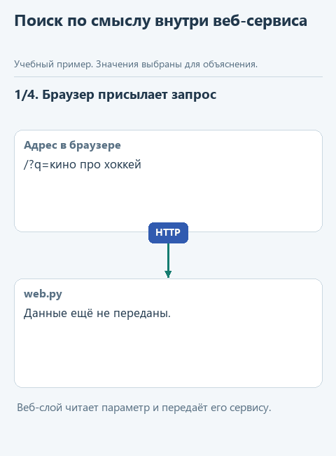
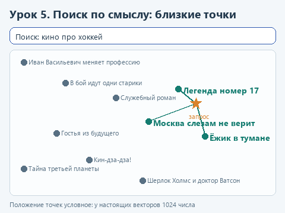

# Урок 5. Модель в веб-сервисе: Эмбеддинги и семантический поиск

[Исходники урока](../exercises/lesson-05-movie-service/README.md) / [Подсказки рядом с кодом](../exercises/lesson-05-movie-service/TASK.md)

> **Где мы находимся:** Наша модель превращается в настоящий веб-сервис! 
> 
> Мы берем работающий сайт домашнего каталога фильмов на фреймворке Flask и встраиваем в него локальную модель векторных эмбеддингов Qwen3-Embedding. Теперь каталог ищет фильмы не по точным буквам, а по смыслу:
> 
> `Браузер -> web.py (Flask) -> CatalogService -> [SemanticSearch: текст -> вектор -> косинусная близость] -> фильмы -> HTML-страница`

---

## В чем проблема обычного поиска по ключевым словам?

Представьте домашний каталог фильмов с веб-интерфейсом в браузере. Вы помните сюжет фильма, но забыли точное название.
Вы вводите в строке поиска: *"кино про хоккей"*.

Обычный поиск по подстроке (как в первом подпроекте первой ступени) выдает грустный пустой результат: `[]`. 
Почему? Потому что в описании фильма "Легенда номер 17" написано: *"История выдающегося советского хоккеиста Валерия Харламова"*. Слова "хоккей" там нет - есть слово "хоккеиста". А на запрос *"добрый мультик перед сном"* поиск никогда не найдет шедевр "Ежик в тумане".

Чтобы поиск понимал синонимы, контекст и ассоциации, в современные системы внедряют **семантический поиск на векторных эмбеддингах (Vector Embeddings)**.

---

## Как нейросеть превращает смысл текста в числа?

Модель эмбеддингов (у нас это `Qwen3-Embedding-0.6B`, около 640 МБ) решает одну математическую задачу: она принимает текст любой длины и превращает его в список из 1024 чисел - числовой **вектор**.

Нейросеть обучена так, что тексты с близким смыслом получают векторы, направленные в одну сторону в многомерном пространстве:
* Фраза *"кино про хоккей"* получает вектор, почти параллельный описанию фильма о советском хоккеисте.
* Фраза *"сдать товар обратно"* окажется рядом со статьей о правилах возврата покупок.

### Как измерить близость двух векторов?
Степень похожести измеряется через **косинус угла между векторами**:
* Косинус равен `1.0` -> смысл абсолютно идентичен.
* Косинус около `0.0` -> тексты никак не связаны по смыслу.

Если векторы заранее нормированы (их длина равна 1), косинусная близость вычисляется элементарно: мы просто перемножаем числа двух векторов попарно и складываем сумму произведений!



<details>
<summary>Посмотреть схему работы веб-сервиса (статичный вариант)</summary>



</details>

---

## Что находится в каркасе урока

1. Скачайте [архив урока](../downloads/lesson-05-movie-service.zip?raw=true), откройте папку `lesson-05-movie-service` в PyCharm.
2. Убедитесь, что выбрано окружение `agent-venv`.
3. В терминале PyCharm установите веб-фреймворк Flask:
```powershell
python -m pip install --only-binary=:all: -r requirements.txt
```
4. Запустите `get_models.py` (**Run 'get_models'**): скрипт скачает модель эмбеддингов `Qwen3-Embedding-0.6B-Q8_0.gguf` (около 640 МБ) в общую папку.

### Запустим веб-сервис в браузере!
Откройте `run.py` и запустите его (**Run 'run'**). В консоли появится:
```text
Каталог открыт: http://127.0.0.1:5000
```
Кликните по ссылке или откройте этот адрес в браузере. Перед вами откроется красивый веб-каталог фильмов! Вы можете посмотреть карточки, фильтровать по тегам и добавлять новые фильмы.

Остановить сервер можно в любой момент красным квадратом **Stop** в панели Run.

---

## Архитектура: как устроен профессиональный веб-сервис

Посмотрите на структуру файлов в проекте - это классическая чистая слоистая архитектура:

```text
[Браузер пользователя]
         │  HTTP-запросы GET/POST
         ▼
      web.py          Веб-слой (Flask): маршруты, параметры URL, рендеринг HTML
         │
      service.py      Бизнес-логика (CatalogService): правила валидации, теги
      ┌──┴─────────────┐
      ▼                ▼
repository.py       search.py
База данных SQLite  Стратегии поиска: KeywordSearch / SemanticSearch
      ▲                ▲
      └──────┬─────────┘
          run.py      Точка сборки: собирает объекты и запускает сервер
```

1. **Слой представления (`web.py`):** знает только про протокол HTTP и шаблоны страниц.
2. **Слой домена (`service.py`):** правила каталога (название не пустое, теги в нижнем регистре). Не зависит от базы данных и веба.
3. **Слой данных (`repository.py`):** паттерн Репозиторий. Прячет SQL-запросы к базе SQLite.
4. **Слой поиска (`search.py`):** паттерн Стратегия. Классы `KeywordSearch` и `SemanticSearch` имеют абсолютно одинаковый метод `find(query, movies, top)`. Сервис вызывает этот метод, даже не догадываясь, какой именно поиск работает под капотом!
5. **Точка сборки (`run.py`):** паттерн Внедрение зависимостей (Dependency Injection). Создает базу, подключает модель и передает их в сервис одной строкой.

---

## Напишите код сами

Откройте `search.py` и найдите метод `find` в классе `SemanticSearch`:

```python
    def find(self, query: str, movies: list[dict], top: int = 3) -> list[dict]:
        raise NotImplementedError('Допишите SemanticSearch.find по подсказкам урока')
```

Замените строчку `raise NotImplementedError(...)` следующим кодом и заполните три пропуска `...`:

```python
        query_vector = self.vector(self.TASK + ...)
        scored = []
        for movie in movies:
            scored.append((cosine(query_vector, self.movie_vector(...)), movie))
        scored.sort(key=lambda pair: pair[0], reverse=True)
        return [movie for score, movie in scored[:...]]
```

1. В вызове `self.vector(...)` склейте пояснение задачи с поисковой фразой: `self.TASK + query`.
2. В `self.movie_vector(...)` передайте текущий фильм: `movie`. Метод автоматически кэширует вектор фильма в словаре `self.vectors`, чтобы не тратить ресурсы процессора на повторный расчет.
3. В срезе списка `[:...]` укажите число лучших результатов: `top`.

---

## Подключите умный поиск в веб-сервер

Откройте `run.py`. Сейчас сервер запускается со старым поиском по словам:

```python
def main():
    serve(build_service(KeywordSearch()))
```

Замените тело функции `main`:

```python
def main():
    with load_embedder() as model:
        serve(build_service(SemanticSearch(model)))
```

Всего одна строка - и весь сайт переключился на нейросетевой семантический поиск!

---

## Запустим и проверим

### 1. Быстрый тест без модели
Запустите `demo_check.py` (**Run 'demo_check'**):
```text
Проверка без модели: путешествие во времени -> Гостья из будущего
```

### 2. Сравнение поиска по словам и по смыслу
Запустите `demo.py` (**Run 'demo'**):

```text
кино про хоккей
  по словам: []
  по смыслу: ['Легенда номер 17', 'Москва слезам не верит', 'Ёжик в тумане']

добрый мультик перед сном
  по словам: []
  по смыслу: ['Ёжик в тумане', 'Москва слезам не верит', 'Служебный роман']
```

Обычный поиск не нашел ничего, а семантический поиск на эмбеддингах мгновенно поставил "Легенду номер 17" и "Ежика в тумане" на первые места!

### 3. Проверка в браузере
Запустите `run.py` (**Run 'run'**), откройте в браузере `http://127.0.0.1:5000` и введите в поиск: *"кино про хоккей"*.
Сайт мгновенно покажет нужный фильм!


---

> 💡 **Для тех, кто хочет вникнуть глубже:** Полный построчный разбор всех модулей проекта и конструкций Python доступен в отдельном руководстве: [Дополнительно: Как устроен веб-сервис каталога фильмов](05-movie-service-modules.md).

---

## Итог урока

* Мы освоили модели векторных эмбеддингов и семантический поиск.
* Поняли, как работает косинусное сходство между векторами смыслов.
* Встроили искусственный интеллект в настоящий веб-сервис на Flask.
* Применили классические инженерные паттерны: Репозиторий, Стратегия и Внедрение зависимостей.

---

## Что дальше

Наш локальный ИИ уже умеет читать текст, смотреть на картинки и понимать смысл в поиске. Но как быть с аудиозаписями?

В следующем уроке мы подключим речевую модель Whisper и научим программу расшифровывать живые голосовые сообщения покупателей с точными таймкодами!

-> [Урок 6. Расшифровка голосовых сообщений: Модель Whisper на CPU](06-speech.md)
