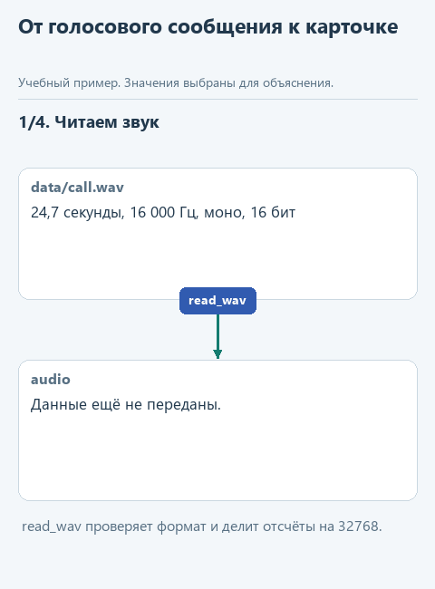
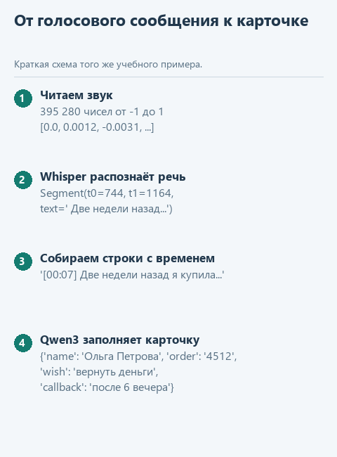

# Урок 6. Расшифровка голосового сообщения

[Исходники урока](../exercises/lesson-06-speech/README.md) / [Подсказки рядом с кодом](../exercises/lesson-06-speech/TASK.md)

> **Где мы.** Соединяем две модели: Whisper превращает голосовое сообщение клиента в текст, языковая модель заполняет по нему карточку обращения. Сегодня пишем функцию `transcribe`.
> **Из основного курса:** магазин и его возвраты, ответ модели в виде структуры, которую дальше обрабатывает программа. Из этой ступени - `ask` со схемой JSON.
> **Новое:** модель распознавания речи, звук как последовательность чисел, отрезки речи с отметками времени, цепочка из двух моделей.
> `call.wav -> read_wav -> числа -> [transcribe: Whisper] -> строки с временем -> call_card: Qwen3 + схема -> карточка`

Клиенты интернет-магазина оставляют голосовые сообщения: в мессенджере или на автоответчике после рабочего дня. Утром оператор прослушивает каждое, записывает имя, номер заказа, суть проблемы и время, когда перезвонить. Сообщение на полминуты требует минуты работы, а их десятки.

Соберём программу, которая сама готовит карточку обращения. Такие системы уже работают в компаниях. Аналитик ЮMoney в [статье о транскрибации созвонов](https://habr.com/ru/post/896096/) описывает, как Whisper расшифровывает звонки в колл-центр для дашборда частых проблем пользователей. Автор с ником SmartAgent в [статье о цепочке "звонок -> JSON"](https://habr.com/ru/articles/1020632/) сравнил распознавание на 200 телефонных записях: локальный Whisper large-v3 ошибался в 14,2% слов, облачный Yandex SpeechKit - в 8,1%. Там же отмечено важное свойство Whisper: неразборчивое место он не помечает, а заменяет правдоподобным, но неверным текстом.

## Whisper на процессоре

Whisper - модель распознавания речи от OpenAI с открытыми весами. Для процессора удобна её реализация whisper.cpp из того же семейства, что и llama.cpp, а из Python к ней обращаются через библиотеку `pywhispercpp`. Файлы моделей лежат в [репозитории whisper.cpp](https://huggingface.co/ggerganov/whisper.cpp).

Мы возьмём модель small, файл `ggml-small.bin` около 490 МБ: она понимает много языков, включая русский. При подготовке курса младшая модель base записала номер заказа "четыре пять один два" как "4.5.1.2", а small - как "4512". Запись длиной 25 секунд small расшифровала примерно за две секунды на компьютере, где проверялся курс.

## Откроем каркас

Скачайте [архив урока](../downloads/lesson-06-speech.zip?raw=true), откройте папку `lesson-06-speech` в PyCharm и выберите общее окружение курса. Установите зависимости, к прежним добавится `pywhispercpp`:

```powershell
python -m pip install --only-binary=:all: -r requirements.txt
```

Запустите `get_models.py`: он скачает Whisper small, а языковую модель возьмёт уже скачанную.

| Файл | Что в нём |
|---|---|
| `data/call.wav` | Голосовое сообщение клиентки, 25 секунд |
| `speech.py` | Чтение звука, расшифровка и карточка обращения. Здесь пишем `transcribe` |
| `demo_check.py` | Проверка функции на подставной модели |
| `demo.py` | Расшифровка настоящим Whisper и карточка от Qwen3 |

Запись `call.wav` мы синтезировали голосом Windows, чтобы не использовать чужой голос. Речь в ней чистая и ровная, на настоящих звонках с шумом Whisper ошибается чаще.

## Как звук превращается в числа

Микрофон много раз в секунду измеряет давление воздуха, и звук хранится как последовательность таких измерений - отсчётов. Whisper ждёт 16 000 отсчётов в секунду, один канал (моно), и каждый отсчёт - целое число от -32768 до 32767. Готовая функция `read_wav` открывает файл модулем `wave` из стандартной библиотеки, проверяет эти три условия и делит числа на 32768, чтобы получить дроби от -1 до 1. Для нашей записи получится 395 280 чисел: 24,7 секунды умножить на 16 000.

Whisper возвращает расшифровку кусками - отрезками речи. У каждого отрезка есть начало `t0`, конец `t1` и текст:

```python
Segment(t0=744, t1=1164, text=' Две недели назад я купила у вас электрический чайник,')
```

Время здесь в сотых долях секунды: 744 - это 7,44 секунды. Текст начинается с пробела, это особенность Whisper.

## Напишите сами

Функция `transcribe` получает загруженную модель Whisper и звук в виде чисел и должна вернуть строки вида `[00:07] Две недели назад...`. Отметка времени нужна оператору: по ней можно быстро найти место в записи и переслушать. Замените строку `raise NotImplementedError(...)` фрагментом ниже и заполните три пропуска:

```python
    segments = model.transcribe(..., language='ru')
    lines = []
    for segment in segments:
        seconds = ...
        lines.append(f'[{seconds // 60:02}:{seconds % 60:02}] {...}')
    return lines
```

1. В `model.transcribe` передайте `audio`.
2. В `seconds` запишите `segment.t0 // 100`: целочисленное деление переводит сотые доли в целые секунды, 744 превращается в 7.
3. В фигурных скобках в конце строки поставьте `segment.text.strip()`: метод `strip` убирает пробел в начале текста.

`seconds // 60` - целые минуты, `seconds % 60` - остаток секунд. Запись `:02` внутри f-строки дополняет число нулём до двух цифр, поэтому 7 секунд превращаются в `00:07`. Параметр `language='ru'` сообщает Whisper язык речи; что будет без него, посмотрим ниже.

## Угадайте до запуска

Клиентка произносит номер заказа словами: "четыре пять один два". Как Whisper запишет его в расшифровке? А как языковая модель заполнит поле `wish` в карточке, если в схеме для него разрешены только "вернуть деньги", "обменять товар", "ремонт", "консультация" и "другое"?

## Запустим

Откройте `demo_check.py` и выберите **Run 'demo_check'**. Подставная модель возвращает два готовых отрезка, а проверка смотрит на отметки времени и язык. После реализации:

```text
Проверка без модели: [00:07] Две недели назад я купила у вас электрический чайник,
```

Теперь **Run 'demo'**. Сначала загрузится Whisper и появится расшифровка, потом загрузится Qwen3 и заполнит карточку. При подготовке курса:

```text
Длина записи: 24.7 сек
Расшифровка за 1.8 сек:
[00:00] Здравствуйте.
[00:02] Меня зовут Ольга Петрова, номер заказа 4512.
[00:07] Две недели назад я купила у вас электрический чайник,
[00:11] а вчера он перестал включаться.
[00:14] Хочу вернуть деньги.
[00:17] Чек у меня сохранился.
[00:19] Перезвоните мне, пожалуйста, после 6 вечера.
Карточка обращения: {'name': 'Ольга Петрова', 'order': '4512', 'problem': 'электрический чайник перестал включаться', 'wish': 'вернуть деньги', 'callback': 'после 6 вечера'}
```

Карточку собирает готовая функция `call_card`: она передаёт строки расшифровки в `ask` с правилом `CALL_RULE` и схемой `CALL_SCHEMA`. Модели по очереди загружаются в отдельных блоках `with`, поэтому в памяти одновременно находится только одна из них.

## Попробуйте сломать

**Уберите язык.** Удалите `, language='ru'` в вызове `model.transcribe` и запустите `demo.py`. При подготовке курса Whisper выдал "Hello. My name is Olga Petrova, order number 4512": библиотека `pywhispercpp` по умолчанию считает речь английской, и Whisper переводит её. Дальше языковая модель заполнит карточку по английскому тексту. Верните `language='ru'`.

**Упростите правило карточки.** В `CALL_RULE` удалите предложение, которое объясняет поля `name`, `order`, `problem` и `callback`. При подготовке курса без него модель вписала в поле `name` слова "Имя клиента" вместо "Ольга Петрова". Пояснение полей работает так же, как пояснение категорий во втором уроке. Верните предложение.

**Запишите своё сообщение.** Приложение Windows "Звукозапись" сохраняет файлы в формате m4a, и `read_wav` ответит ошибкой `Нужен WAV: 16 000 Гц, один канал, 16 бит`. Если у вас установлена программа ffmpeg, переведите запись командой ниже и укажите новый файл в `demo.py`:

```powershell
ffmpeg -i запись.m4a -ar 16000 -ac 1 data\my.wav
```

## Что мы получили

Две модели работают цепочкой: Whisper превращает звук в текст с отметками времени, Qwen3 по схеме превращает текст в карточку. Ошибка на первом шаге переходит во второй, поэтому оператор видит рядом и карточку, и расшифровку с временем, по которому можно переслушать запись.



<details>
<summary>Статичный вариант</summary>



</details>

Дальше: [урок 7. Telegram-бот на локальной модели](07-telegram-bot.md).
