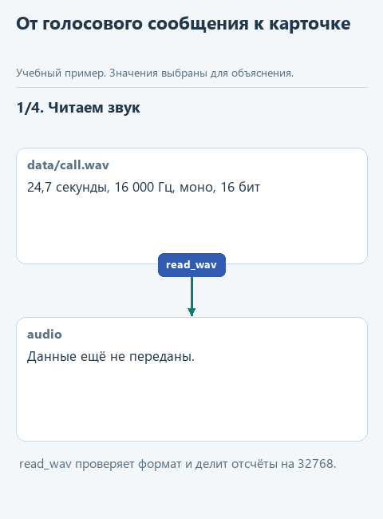
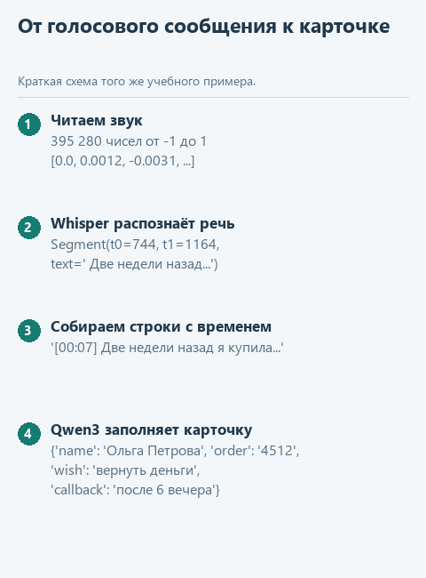

# Урок 6. Расшифровка голосовых сообщений: Модель Whisper на CPU

[Исходники урока](../exercises/lesson-06-speech/README.md) / [Подсказки рядом с кодом](../exercises/lesson-06-speech/TASK.md)

> **Где мы находимся:** Соединяем две разные нейросети в один рабочий конвейер! 
> 
> Речевая модель Whisper переводит звуковое сообщение клиентки в текст с точными временными метками, а языковая модель Qwen3 извлекает из текста структурированную карточку обращения:
> 
> `Аудиофайл call.wav -> [Whisper: звук -> текст с таймкодами] -> [Qwen3 + схема JSON] -> готовая карточка заявки`

---

## В чем бизнес-задача?

Покупатели интернет-магазина часто оставляют голосовые сообщения: в чатах поддержки или на автоответчике в нерабочие часы. 

Утром дежурному оператору приходится вручную отслушивать десятки записей:
* Выписывать имя клиента и номер заказа.
* Разбирать суть претензии (что сломалось или не подошло).
* Фиксировать пожелание клиента (вернуть деньги, обменять товар или прислать мастера) и удобное время для обратного звонка.

Прослушивание даже 30-секундного аудио занимает у человека минуту-полторы. При потоке в сотни звонков сотрудники тратят на рутину половину рабочего дня.

Мы создадим автоматический конвейер: локальный Whisper мгновенно транскрибирует аудио прямо на процессоре ноутбука, а языковая модель раскладывает расшифровку по полям строгой JSON-карточки.

Похожую архитектуру используют ведущие финтех-компании и контакт-центры (например, ЮMoney): звонки клиентов переводятся в текст, после чего аналитическая система строит дашборды частых проблем и автоматически заполняет тикеты.

---

## Как Whisper работает на процессоре?

Модель **Whisper** создана компанией OpenAI с открытыми весами. 

Благодаря оптимизированному движку `whisper.cpp` (созданному Георгием Гергановым, автором `llama.cpp`), Whisper работает с потрясающей скоростью на обычном процессоре ноутбука! Из Python мы управляем им через библиотеку `pywhispercpp`.

В уроке мы используем модель **Whisper-Small** (`ggml-small.bin`, около 490 МБ). Она отлично понимает русскую речь и четко распознает цифры: например, фразу *"четыре пять один два"* она аккуратно записывает как число `"4512"`.

Запись длительностью 25 секунд на обычном процессоре расшифровывается всего за 1.5 - 2 секунды!



<details>
<summary>Посмотреть схему работы со звуком (статичный вариант)</summary>



</details>

---

## Что находится в каркасе урока

1. Скачайте [архив урока](../downloads/lesson-06-speech.zip?raw=true), откройте папку `lesson-06-speech` в PyCharm.
2. Убедитесь, что выбрано окружение `agent-venv`.
3. Установите речевую библиотеку `pywhispercpp`:
```powershell
python -m pip install --only-binary=:all: -r requirements.txt
```
4. Запустите `get_models.py` (**Run 'get_models'**): скрипт скачает веса `ggml-small.bin` (488 МБ) в нашу общую папку моделей.

### Карта файлов проекта:
| Файл | За что отвечает |
|---|---|
| `data/call.wav` | Реалистичное голосовое сообщение клиентки длительностью 25 секунд |
| `speech.py` | Чтение звука, транскрипция Whisper и формирование карточки через Qwen3 |
| `demo_check.py` | Быстрый тест без загрузки тяжелых моделей |
| `demo.py` | Сквозной боевой прогон: расшифровка звука + заполнение JSON-карточки |

---

## Как звук превращается в числа для нейросети?

Звук в файле `.wav` хранится как последовательность измерений давления воздуха (отсчетов). 

Модель Whisper требует стандартный формат:
* Частота дискретизации: ровно 16 000 измерений в секунду (16 кГц).
* 1 аудиоканал (моно).
* 16 бит на отсчет (значения от -32768 до +32767).

Готовая функция `read_wav` считывает байты стандартным модулем Python `wave` и делит числа на 32768, получая удобные для нейросети дроби от -1.0 до +1.0.

При распознавании Whisper возвращает список сегментов речи. У каждого сегмента есть время начала `t0`, время конца `t1` (в сотых долях секунды) и распознанный текст:
```python
Segment(t0=744, t1=1164, text=' Две недели назад я купила у вас электрический чайник,')
```
Значение `t0=744` означает 7.44 секунды от начала записи.

---

## Напишите код сами

Откройте `speech.py` и найдите функцию `transcribe`:

```python
def transcribe(model, audio: list[float]) -> list[str]:
    raise NotImplementedError('Допишите transcribe по подсказкам урока')
```

Замените строчку `raise NotImplementedError(...)` следующим кодом и заполните три пропуска `...`:

```python
    segments = model.transcribe(..., language='ru')
    lines = []
    for segment in segments:
        seconds = ...
        lines.append(f'[{seconds // 60:02}:{seconds % 60:02}] {...}')
    return lines
```

1. В вызове `model.transcribe` передайте входящий массив звуковых чисел: `audio`.
2. В переменную `seconds` переведите сотые доли в целые секунды: `segment.t0 // 100` (целочисленное деление превращает 744 в 7 секунд).
3. В фигурных скобках в конце строки добавьте очищенный текст сегмента: `segment.text.strip()` (метод `strip` убирает технический пробел, который Whisper ставит перед фразами).

### Разбор форматирования времени:
* `seconds // 60` - минуты.
* `seconds % 60` - остаток секунд.
* Спецификатор `:02` дополняет число нулем слева (7 превращается в красивое `00:07`). В итоге оператор видит строчки вида: `[00:07] Две недели назад я купила у вас электрический чайник...`.

---

## Запустим и проверим

### 1. Быстрый тест без модели
Запустите `demo_check.py` (**Run 'demo_check'**):
```text
Проверка без модели: [00:07] Две недели назад я купила у вас электрический чайник,
```

### 2. Сквозной запуск двух моделей
Запустите `demo.py` (**Run 'demo'**).
Программа выполнит полный двухэтапный конвейер:

```text
Длина записи: 24.7 сек
Расшифровка за 1.8 сек:
[00:00] Здравствуйте.
[00:02] Меня зовут Ольга Петрова, номер заказа 4512.
[00:07] Две недели назад я купила у вас электрический чайник,
[00:11] а вчера он перестал включаться.
[00:14] Хочу вернуть деньги.
[00:17] Чек у меня сохранился.
[00:19] Перезвоните мне, пожалуйста, после 6 вечера.

Карточка обращения: {
  'name': 'Ольга Петрова',
  'order': '4512',
  'problem': 'электрический чайник перестал включаться',
  'wish': 'вернуть деньги',
  'callback': 'после 6 вечера'
}
```

### Разбор работы конвейера:
1. За 1.8 секунды Whisper перевел голос в чистый текст с таймкодами.
2. Память Whisper сразу освободилась (`del model`).
3. В память загрузилась языковая модель Qwen3, прочитала расшифровку и сформировала структурированный JSON: выделила имя, номер заказа, суть проблемы и время звонка!

Оператору больше не нужно слушать аудио целиком: он сразу видит суть проблемы, а если сомневается - по таймкоду `[00:11]` может перемотать запись ровно на нужное место.


---

> 💡 **Для тех, кто хочет вникнуть глубже:** Полный построчный разбор всех модулей проекта и конструкций Python доступен в отдельном руководстве: [Дополнительно: Как устроен speech.py](06-speech-module.md).

---

## Итог урока

* Мы освоили модель распознавания речи Whisper на процессоре через `pywhispercpp`.
* Поняли, как звук представляется в виде числовых отсчетов и нарезается на сегменты.
* Собрали связку из двух моделей: специализированная речевая сеть + структурирующая языковая модель.

---

## Что дальше

Мы подошли к финальному проекту курса!
В следующем уроке мы объединим все полученные знания и создадим **полноценного Telegram-бота** на локальной модели, который взаимодействует с базой данных Excel и ведет журнал в реальном времени!

-> [Урок 7. Telegram-бот на локальной модели](07-telegram-bot.md)
