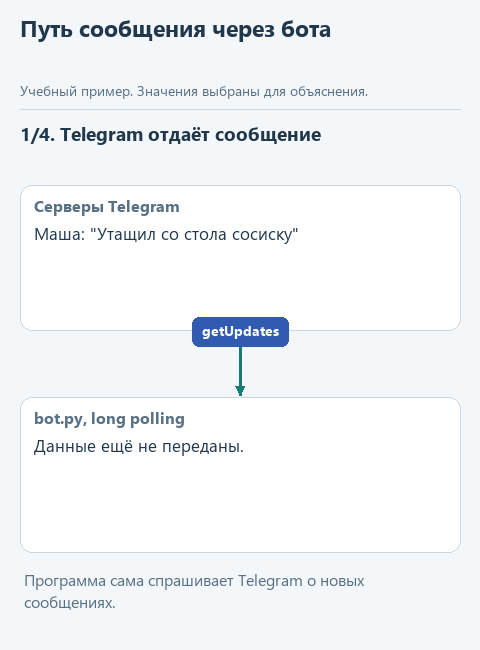
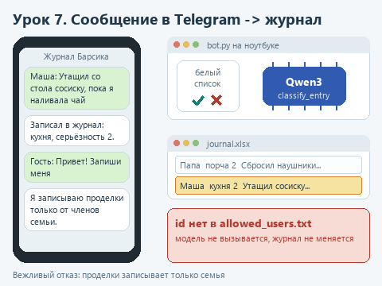

# Урок 7. Telegram-бот на локальной модели (Финальный проект)

[Исходники урока](../exercises/lesson-07-telegram-bot/README.md) / [Подсказки рядом с кодом](../exercises/lesson-07-telegram-bot/TASK.md)

> **Где мы находимся:** Финал второй ступени! 
> 
> Мы создаем полноценного Telegram-бота, работающего на локальной модели Qwen3 без облачных серверов. 
> 
> Бот принимает сообщения от авторизованных пользователей, классифицирует текст нейросетью, дописывает новые строки в семейный журнал Excel из Урока 2 и по команде `/summary` присылает аналитическую сводку:
> 
> `Сообщение в чате Telegram -> [bot.py: проверка белого списка] -> [bot_logic: классификация Qwen3] -> запись в Excel -> ответ пользователю`

---

## В чем практический смысл задачи?

Во втором уроке мы создали настольную утилиту для журнала кота Барсика. Но у десктопного приложения есть бытовое ограничение: оно работает на одном компьютере. Если кот стащил сосиску на кухне при бабушке, ей приходится идти в комнату и открывать ноутбук.

Гораздо удобнее написать боту в Telegram прямо с телефона:
1. Кто угодно из членов семьи пишет боту короткое сообщение: *"Кот уронил горшок с цветком на балконе"*.
2. Бот мгновенно классифицирует запись локальной нейросетью ("порча вещей", серьезность 2).
3. Дописывает новую строчку в общую таблицу Excel.
4. Отвечает в чат подтверждением.
5. А вечером по команде `/summary` присылает красивый структурированный отчет за день!

---

## Архитектура Telegram-бота: как он работает без белого IP-адреса?

Для запуска нашего бота не нужны аренда серверов, доменные имена, открытые порты или публичный IP-адрес.

Бот использует технологию **Long Polling (длинный опрос)**:
1. Ваш скрипт Python сам подключается к серверам Telegram и держит открытое соединение, спрашивая: *"Есть ли новые сообщения для меня?"*.
2. Как только пользователь отправляет сообщение боту, сервер Telegram мгновенно отдает его вашему скрипту.
3. Скрипт обрабатывает запрос локальной нейросетью и отправляет ответ обратно в чат.

Бот работает автономно прямо на вашем ноутбуке, пока запущен файл `bot.py`! Если ноутбук был временно выключен, Telegram сохраняет сообщения до 24 часов и передаст их боту при следующем запуске.



<details>
<summary>Посмотреть схему работы Telegram-бота (статичный вариант)</summary>



</details>

---

## 1. Регистрация бота и получение токена (BotFather)

1. Откройте Telegram и найдите официального бота **`@BotFather`** (с синей галочкой верификации).
2. Нажмите **Start** и отправьте команду `/newbot`.
3. Задайте имя бота (например, `Журнал Барсика`).
4. Придумайте уникальный никнейм на латинице, заканчивающийся на `bot` (например, `barsik_notes_2026_bot`).
5. BotFather поздравит вас и пришлет длинный секретный **токен** вида `1234567890:AA...`.

---

## 2. Безопасность: храним токен вне программного кода

Никогда не вставляйте секретные токены прямо в `.py` файлы! Иначе при первой отправке кода в Git или случайном скриншоте ваш токен попадет в чужие руки.

Мы сохраним токен в изолированную системную папку на компьютере:
1. В Проводнике откройте вашу папку пользователя: `C:\Users\<Ваше_Имя>`.
2. Создайте в ней отдельную папку: `agent-secrets`.
3. Внутри создайте текстовый файл `telegram_token.txt` и вставьте туда одну строчку с вашим токеном от BotFather.

Функция `read_token()` в `bot.py` автоматически прочитает токен из этого безопасного файла или переменной окружения `TELEGRAM_BOT_TOKEN`.

---

## 3. Каркас урока и зависимости

1. Скачайте [архив урока](../downloads/lesson-07-telegram-bot.zip?raw=true), откройте папку `lesson-07-telegram-bot` в PyCharm.
2. Убедитесь, что выбрано общее окружение `agent-venv`.
3. Установите библиотеку Telegram Bot API:
```powershell
python -m pip install --only-binary=:all: -r requirements.txt
```

### Карта файлов проекта:
| Файл | За что отвечает |
|---|---|
| `bot_logic.py` | Чистая логика бота: формирование ответов, белый список и функция `handle_text` |
| `bot.py` | Взаимодействие с Telegram: регистрация команд, обработчики сообщений, long polling |
| `journal_ai.py`, `journal_io.py` | Модули классификации и записи в Excel из Урока 2 |
| `data/journal.xlsx` | Семейный файл таблицы Excel |
| `data/allowed_users.txt` | Белый список Telegram ID пользователей, которым разрешено писать в журнал |
| `demo_check.py` | Быстрая проверка логики без сети и Telegram |
| `demo.py` | Тестовый диалог с ботом в консоли на реальной модели |

---

## Белый список (Whitelist): железный контроль доступа

В Telegram любой посторонний человек может найти вашего бота по никнейму. Если оставить бота открытым, любой желающий сможет засорить семейную таблицу Excel.

В нашем проекте безопасность вшита на уровне программного кода:
В файле `data/allowed_users.txt` хранится список разрешенных числовых ID пользователей (по одному на строчку).
* Когда приходит сообщение, декоратор в `bot.py` сверяет `message.from_user.id` со списком.
* Если пользователя нет в файле - бот вежливо отказывает и не пускает сообщение к нейросети и базе данных!

Свой персональный числовой ID вы легко узнаете, отправив боту команду `/id`.

---

## Напишите код сами

Откройте файл `bot_logic.py` и найдите функцию `handle_text`:

```python
def handle_text(model, journal_path: Path, author: str, text: str) -> str:
    # Защитные проверки на пустой и чересчур длинный ввод уже подготовлены:
    text = text.strip()
    if not text:
        return 'Пришлите непустой текст проделки.'
    if len(text) > 300:
        return 'Слишком длинное сообщение: сократите до 300 знаков.'
    raise NotImplementedError('Допишите handle_text по подсказкам урока')
```

Замените строчку `raise NotImplementedError(...)` следующим кодом и заполните два пропуска `...`:

```python
    entry = classify_entry(model, ...)
    append_entry(journal_path, author, text, extra=(entry['category'], entry['severity']))
    return f'Записал в журнал: {entry["category"]}, серьёзность {...}.'
```

1. В вызов функции `classify_entry` передайте текст сообщения: `text`.
2. В итоговой f-строке после слова "серьёзность" подставьте поле из ответа модели: `entry["severity"]`.

Функция `append_entry` из модуля `journal_io.py` сама добавит в файл Excel строку с сегодняшней датой, именем автора, текстом сообщения, категорией и баллом серьезности!

---

## Запустим и проверим

### 1. Быстрый тест без сети и Telegram
Запустите `demo_check.py` (**Run 'demo_check'**):
```text
Проверка без модели: Записал в журнал: кухня, серьёзность 1.
```

### 2. Консольный прогон тестового диалога
Запустите `demo.py` (**Run 'demo'**).
Программа промоделирует диалог в консоли на реальной локальной модели Qwen3:
```text
Маша: Утащил со стола сосиску, пока я наливала чай
Бот: Записал в журнал: кухня, серьёзность 2.
Папа: Сбросил с полки мои наушники, отломался амбушюр
Бот: Записал в журнал: порча, серьёзность 2.
Бот на /summary: Последние записи по категориям: {'кухня': 1, 'порча': 1}
```

---

## 4. Боевой запуск бота в Telegram!

1. Откройте `bot.py` и запустите его (**Run 'bot'**). В консоли появится:
   ```text
   Загружаем Qwen3-1.7B-Q8_0.gguf...
   Бот запущен, разрешённых пользователей: 0
   ```
2. Откройте вашего бота в Telegram и нажмите **Start**. Бот пришлет приветствие.
3. Отправьте команду `/id`. Бот ответит: `Ваш id: 123456789`.
4. Нажмите красный квадрат **Stop** в PyCharm. Откройте файл `data/allowed_users.txt`, вставьте туда ваш числовой ID с новой строчки и сохраните файл.
5. Запустите `bot.py` снова (**Run 'bot'**). Теперь написано: `разрешённых пользователей: 1`.
6. Напишите боту проделку:
   > *"Уснул в коробке из-под обуви и громко сопел"*
   
   В Telegram загорится статус *"печатает..."*, и через пару секунд придет ответ:
   > *Записал в журнал: нежности, серьёзность 1.*
   
7. Отправьте боту команду `/summary`: бот сгенерирует аналитическую сводку по категориям!
8. Откройте `data/journal.xlsx` в Excel: внизу таблицы появилась ваша новая запись! *(Перед следующей отправкой закройте файл в Excel, чтобы Windows не блокировала запись).*

---

## Итог урока и всего курса

Поздравляем с созданием полноценного рабочего ИИ-продукта!
* Бот работает 24/7 прямо на вашем локальном компьютере.
* Не требует оплаты облачных API.
* Защищен белым списком пользователей на уровне Python-кода.
* Интегрирован с реальной базой данных Excel.

---

-> [Перейти к заключению: Что мы собрали и где это пригодится](conclusion.md)
