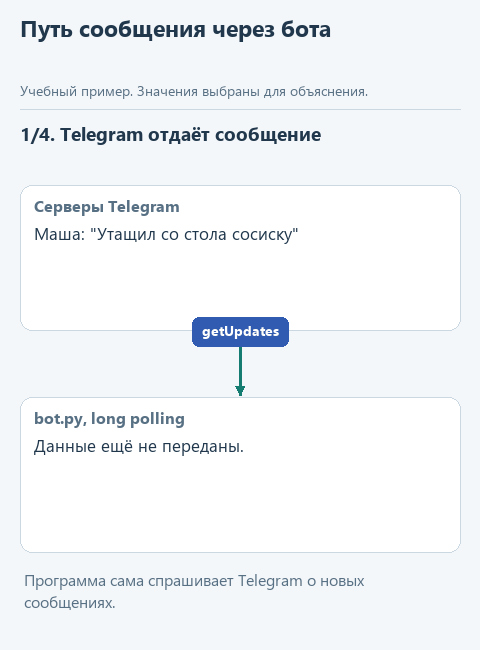
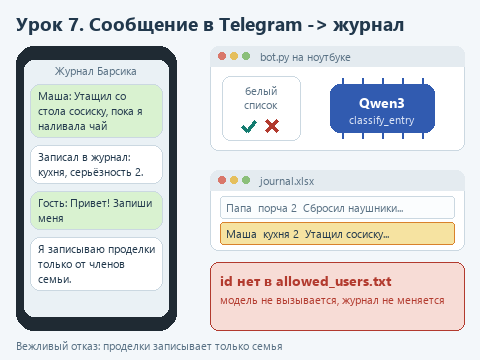

# Урок 7. Telegram-бот на локальной модели

[Исходники урока](../exercises/lesson-07-telegram-bot/README.md) / [Подсказки рядом с кодом](../exercises/lesson-07-telegram-bot/TASK.md)

> **Где мы.** Последнее приложение курса: Telegram-бот, через которого вся семья пополняет журнал проделок кота из второго урока. Сегодня пишем функцию `handle_text`, которая обрабатывает сообщение.
> **Из основного курса:** граница возможностей агента задаётся в коде, а не в промпте; журнал действий. Из этой ступени - журнал Excel и функция `classify_entry` из урока 2.
> **Новое:** Telegram Bot API, создание бота у BotFather, токен вне кода, long polling, обработчики сообщений, белый список пользователей.
> `сообщение в Telegram -> bot.py -> белый список -> handle_text -> classify_entry -> журнал Excel -> ответ в чат`

Во втором уроке журнал Барсика вели в Excel на одном компьютере. Неудобно: проделку видит бабушка на кухне, а ноутбук у Маши в комнате. Пусть записи приходят через Telegram: кто увидел, тот написал боту, а бот разобрал запись моделью, добавил в журнал и ответил категорией. По команде `/summary` бот пришлёт сводку.

Бот на локальной модели - популярный домашний проект. Автор с ником rocet в [статье на Хабре](https://habr.com/ru/articles/1008248/) рассказывает, как вырастил такого бота от простого собеседника до мини-игр. Проблемы у него знакомые: бот работает, только пока включён его домашний компьютер; модель упорно отвечала формулами LaTeX, которые Telegram не показывает, и просьбы в промпте не помогали, пришлось чистить ответ регулярными выражениями; длинные ответы не влезали в лимит Telegram в 4096 символов. У нашего бота ответы короткие и собираются программой, но первое ограничение то же: бот работает, пока запущен `bot.py`.

## Как бот получает сообщения

Бот в Telegram - это особая учётная запись, которой управляет программа. Программа общается с серверами Telegram через Bot API, а доступ к нему даёт токен - строка вида `1234567890:AA...`. Токен равен паролю: кто его знает, тот управляет ботом.

Наш бот использует long polling: программа сама спрашивает серверы Telegram, нет ли новых сообщений, и ждёт ответа до нескольких десятков секунд. Пришло сообщение - сервер сразу его отдаёт, программа обрабатывает и спрашивает снова. Публичный адрес и открытые порты для этого не нужны: ноутбуку достаточно выхода в интернет. Если программа была выключена, Telegram хранит новые сообщения для бота до 24 часов и отдаст их при следующем запуске.

Для администратора здесь важна граница: модель работает на вашем ноутбуке, но сами сообщения проходят через серверы Telegram. Для журнала кота это не беда, а рабочие данные через такого бота отправлять стоит, только если это разрешено.



<details>
<summary>Статичный вариант</summary>



</details>

## Создадим бота

1. В Telegram найдите `@BotFather` - официального бота для создания ботов, с синей галочкой.
2. Отправьте ему `/newbot`. На вопрос об имени ответьте, например, `Журнал Барсика` - это имя увидят в чате.
3. Затем придумайте адрес бота латиницей, он должен заканчиваться на `bot`, например `barsik_journal_2026_bot`. Если адрес занят, BotFather попросит другой.
4. BotFather пришлёт сообщение с токеном. Скопируйте токен и никому не пересылайте. Если он всё-таки утёк, отправьте BotFather `/revoke`, выберите бота и получите новый.

## Токен вне кода

Токен нельзя вписывать в `bot.py`: файл попадёт в архив, в репозиторий, на скриншот в чате с коллегой. Сохраним его в отдельную папку вне проекта:

1. В Проводнике откройте папку пользователя `C:\Users\Имя` и создайте в ней папку `agent-secrets`.
2. Откройте Блокнот, вставьте токен одной строкой и сохраните файл в эту папку под именем `telegram_token.txt`. В поле "Тип файла" выберите "Все файлы", чтобы Блокнот не дописал второе расширение.

Готовая функция `read_token` в `bot.py` сначала смотрит переменную окружения `TELEGRAM_BOT_TOKEN`, а если её нет, читает этот файл. Если не найдёт ни того, ни другого, программа остановится и подскажет, куда положить токен.

## Откроем каркас

Скачайте [архив урока](../downloads/lesson-07-telegram-bot.zip?raw=true), откройте папку `lesson-07-telegram-bot` в PyCharm и выберите общее окружение курса: щёлкните имя интерпретатора в правом нижнем углу окна PyCharm и выберите в списке `agent-venv`, а не `.venv` из папки урока, где нет библиотек курса. Установите зависимости, к прежним добавится библиотека `pyTelegramBotAPI`:

```powershell
python -m pip install --only-binary=:all: -r requirements.txt
```

| Файл | Что в нём |
|---|---|
| `bot_logic.py` | Что ответить на сообщение. Здесь нет ничего от Telegram. Здесь пишем `handle_text` |
| `bot.py` | Подключение к Telegram: токен, обработчики, long polling |
| `journal_ai.py`, `journal_io.py` | Разбор записи и работа с Excel из урока 2, уже готовые |
| `data/journal.xlsx` | Журнал с двенадцатью записями из урока 2 |
| `data/allowed_users.txt` | Белый список: кому можно писать в журнал |
| `demo_check.py` | Проверка функции на подставной модели |
| `demo.py` | Разговор с ботом без Telegram, на настоящей модели |

Если языковую модель ещё не скачивали, запустите `get_models.py`: в дереве проекта щёлкните по файлу правой кнопкой и выберите **Run 'get_models'**. Уже скачанный файл программа оставит на месте. Для следующих запусков выбирайте нужный файл тем же способом: кнопка на верхней панели повторяет ранее выбранную конфигурацию.

## Как устроен bot.py

Откройте `bot.py`. Объект бота создаётся одной строкой:

```python
bot = telebot.TeleBot(read_token(), threaded=False)
```

Дальше идут обработчики - функции, которые библиотека вызывает при новом сообщении:

```python
@bot.message_handler(commands=['id'])
def send_id(message):
    bot.reply_to(message, f'Ваш id: {message.from_user.id}')
```

Строка с `@` над функцией - декоратор: она регистрирует функцию как обработчик команды `/id`. В `message` библиотека передаёт сообщение со всеми сведениями: текст, чат, отправитель. `bot.reply_to` отправляет ответ на это сообщение. Обработчики проверяются в порядке объявления, поэтому команды объявлены раньше общего обработчика текста `content_types=['text']`, который ловит всё остальное.

`bot.infinity_polling()` в конце запускает бесконечный цикл long polling. Параметр `threaded=False` заставляет обрабатывать сообщения по одному: модель у нас одна, и два одновременных вызова ей ни к чему.

## Белый список

Найти бота в Telegram может любой, кто угадает его адрес. Поэтому журнал пополняют только люди из файла `data/allowed_users.txt`: в нём номера пользователей Telegram, по одному в строке. Это id - постоянный номер учётной записи, он не меняется при смене имени. Свой id каждый может узнать командой `/id`. Обработчики `/summary` и текста сначала сверяют `message.from_user.id` со списком и чужим вежливо отказывают.

Кто и что может делать с ботом, решает тот, кто ведёт этот файл, - в семье это хозяин ноутбука, в компании - администратор. Правило записано в коде, и никакое сообщение в чате его не изменит.

## Напишите сами

Откройте `bot_logic.py`. Функция `handle_text` получает модель, путь к журналу, имя автора и текст сообщения. Проверки пустого и слишком длинного текста уже есть: длинный текст не дойдёт до модели. Замените строку `raise NotImplementedError(...)` фрагментом ниже и заполните два пропуска:

```python
    entry = classify_entry(model, ...)
    append_entry(journal_path, author, text, extra=(entry['category'], entry['severity']))
    return f'Записал в журнал: {entry["category"]}, серьёзность {...}.'
```

1. В `classify_entry` передайте `text`. Это та самая функция из второго урока, здесь она уже готова.
2. В ответе после слова "серьёзность" поставьте `entry["severity"]` - с двойными кавычками, потому что вся f-строка в одинарных.

`append_entry` из `journal_io.py` дописывает в конец журнала строку с сегодняшней датой, автором и текстом, а через `extra` - ещё категорию и серьёзность в столбцы D и E. Утилита из второго урока читает первые три столбца, поэтому откроет пополненный журнал без изменений.

## Угадайте до запуска

Что ответит бот, если кто-то из семьи по ошибке напишет ему "Какая погода завтра?" И что увидит человек, которого нет в белом списке?

## Запустим без Telegram

Откройте `demo_check.py` и выберите **Run 'demo_check'**. Проверка работает с копией журнала во временной папке и подставной моделью, поэтому настоящий журнал не меняется. После реализации:

```text
Проверка без модели: Записал в журнал: кухня, серьёзность 1.
```

Теперь **Run 'demo'**. Это разговор с ботом без Telegram: две записи от Маши и папы и команда `/summary`, а журнал - копия `data/demo-journal.xlsx`. При подготовке курса:

```text
Маша: Утащил со стола сосиску, пока я наливала чай
Бот: Записал в журнал: кухня, серьёзность 2.
Папа: Сбросил с полки мои наушники, отломался амбушюр
Бот: Записал в журнал: порча, серьёзность 2.
Бот на /summary: Последние записи по категориям: {'кухня': 1, 'порча': 1}
```

Под подсчётом идёт сводка от модели. `demo.py` вызывает те же функции, что и `bot.py`, поэтому до встречи с Telegram мы уже знаем, что логика бота работает.

## Запустим в Telegram

1. В дереве проекта щёлкните правой кнопкой по `bot.py` и выберите **Run 'bot'**. Модель загрузится, в Run появится `Бот запущен, разрешённых пользователей: 0`.
2. В Telegram откройте своего бота по адресу, который вы дали в BotFather, и нажмите **Start**. Бот ответит текстом справки.
3. Отправьте `/id`. Бот пришлёт ваш номер.
4. Остановите бота кнопкой **Stop**, откройте `data/allowed_users.txt` и впишите номер новой строкой. Список читается при запуске, поэтому запустите `bot.py` снова.
5. Напишите боту проделку, например "Спал в коробке из-под обуви". Пока модель думает, в чате будет видно "печатает...", потом придёт ответ с категорией.
6. Отправьте `/summary` и получите сводку. Откройте `data/journal.xlsx` в Excel - новые записи в конце листа. Перед следующей записью закройте файл в Excel: пока он открыт, Windows не даст его перезаписать, и бот попросит закрыть журнал.

Чтобы бот мог пополнять журнал, ноутбук должен быть включён, а `bot.py` - запущен.

## Попробуйте сломать

**Напишите не о коте.** Отправьте "Какая погода завтра?". При подготовке курса модель отнесла такие сообщения к категории "шум": схема разрешает только пять категорий, и одну из них модель выбрать обязана. Чтобы бот не засорял журнал, можно добавить в `CATEGORIES` шестую категорию, например "не о коте", и в `handle_text` не записывать такие сообщения. Попробуйте сделать это сами.

**Напишите с чужого аккаунта.** Попросите кого-нибудь написать боту. Человек получит отказ и подсказку про `/id`, а журнал не изменится.

**Выключите бота.** Остановите `bot.py`, отправьте ему пару сообщений и запустите снова. Бот обработает их после запуска: Telegram хранил их всё это время.

## Что мы получили

Бот принимает сообщения от семьи, пускает в журнал только людей из белого списка, разбирает записи той же моделью, что и утилита из второго урока, и пишет в тот же Excel. Логика бота лежит отдельно от Telegram, поэтому её можно проверить без сети, а токен хранится вне проекта.

Дальше: [заключение](conclusion.md).
