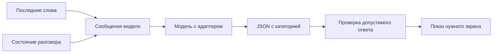
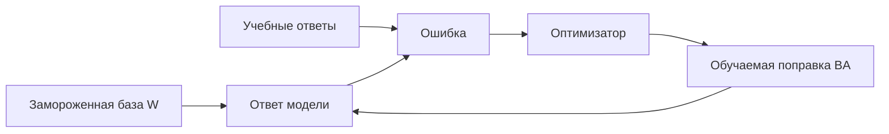

# Дообучение небольшой модели на синтетических диалогах

> **Где мы находимся.** В уроке 3 вы попросили модель выбрать ответ из списка, а в уроке 6 получили текст из звука. Теперь разберемся, что делать, если небольшая модель понимает отдельную просьбу, но ошибается в похожих формулировках и коротких продолжениях разговора. У нас будет самостоятельный учебный пример: распределение обращений читателей библиотеки.

Сначала пройдите основные уроки 1 и 3. Для чтения этого дополнения и проверки данных видеокарта не нужна. Для предложенного запуска обучения нужен отдельный компьютер с NVIDIA CUDA и достаточно памяти. Это дополнительная лабораторная работа; требования семи основных уроков остаются прежними.

**Что здесь действительно проверено:** генерация и разделение данных, маска ответа, синтаксис учебных скриптов, сборка архива и ссылки. Обучение весов на этом наборе и измерение качества модели еще не выполнялись. Поэтому ниже есть команды для вашего эксперимента, но нет выдуманного результата "после обучения стало лучше".

Скачайте [архив с кодом и датасетом](../downloads/fine-tuning-dialogues.zip?raw=true). Распакуйте папку `fine-tuning-dialogues` и откройте ее в PyCharm. Здесь даны готовые учебные скрипты, а не заготовки с `NotImplementedError`.

## 1. Какую задачу решаем

Представьте форму для читателей библиотеки. Человек пишет сообщение, а программа определяет, какой экран показать библиотекарю. Она пока не меняет срок выдачи и не отправляет сообщения читателю. Ее единственный результат - одна из четырех категорий.

| Категория в коде | Что означает | Пример |
|---|---|---|
| `renew` | Прямая просьба продлить известную выдачу книги | "Продлите выдачу книги Маяк на острове на неделю" |
| `find` | Просьба найти книгу | "Покажите карточку книги Атлас старых дорог" |
| `question` | Вопрос о правилах или отказ от изменения | "Вы умеете продлевать книги?" |
| `clarify` | Для понимания не хватает предмета разговора | "Еще на неделю", когда неизвестно, о чем речь |

Теперь усложним задачу. В предыдущем сообщении читатель выбрал выданную ему книгу, а затем написал: "Еще на неделю". Слова те же, но появился контекст. Категория теперь `renew`.

Контекст - сведения, которые программа передает вместе с последними словами. В нашем примере это поле `current_loan`: название выбранной выдачи. Это не скрытая память модели. Если программа не передаст поле, нейросеть его не узнает.



В таком устройстве модель отвечает за смысл фразы. Программа проверяет формат и решает, разрешено ли действие. Даже удачно дообученная модель не должна сама становиться библиотечной базой данных.

## 2. Сначала проверьте, действительно ли требуется обучение

Дообучение, или fine-tuning, меняет числовые параметры модели на примерах нужного поведения. Оно требует данных и проверки. Не каждую ошибку надо исправлять таким способом.

Если модель не увидела выбранную книгу, исправьте передачу контекста. Если она дала правильную категорию, но программа открыла другой экран, исправьте код. Если нужна актуальная доступность книги, запросите каталог. Обучение не заменяет эти части системы.

Дообучение имеет смысл исследовать, когда исходная модель получает понятную инструкцию и нужные сведения, но регулярно путает просьбу с вопросом или плохо соблюдает формат. Сначала сохраните исходный результат на отложенных примерах. Затем сравните с дообученной версией. Если улучшения нет, эксперимент тоже дал полезный ответ.

| Средство | Что меняется | Для чего подходит |
|---|---|---|
| Промпт | Текст инструкции перед очередным ответом | Описать задачу и формат |
| Контекст | Сведения о текущем разговоре | Понять "ее", "еще неделю", "ту книгу" |
| Поиск или API | Получаемые внешние факты | Узнать наличие книги сейчас |
| Код | Проверки и выполнение действия | Не создать две записи, проверить номер выдачи |
| Дообучение | Часть весов модели | Закрепить нужное поведение на разнообразных примерах |

## 3. Базовая модель и небольшой обучаемый адаптер

В примере выбрана текстовая `Qwen/Qwen3-0.6B`. Это небольшая модель для учебной лаборатории, а не утверждение, что она лучше всех понимает русский язык. Ее исходная карточка находится у [разработчика Qwen](https://huggingface.co/Qwen/Qwen3-0.6B). Обучаемую поправку будем делать через библиотеку [PEFT](https://huggingface.co/docs/peft/en/quicktour).

Мы закрепили ревизию `c1899de289a04d12100db370d81485cdf75e47ca`. Ревизия - идентификатор конкретного состояния файлов. Если у автора появятся новые веса под тем же названием, наш загрузчик продолжит запрашивать прежние. Это помогает повторять опыт. Скрипт `get_model.py` сохраняет название и ревизию в `provenance.json` рядом с моделью.

Полное обучение с нуля означало бы заново учить языку большую нейросеть. Здесь мы берем уже обученную базу и добавляем LoRA. Название расшифровывается как Low-Rank Adaptation, адаптация с поправкой низкого ранга. Базовые веса остаются замороженными: оптимизатор их не меняет. Он меняет только небольшие дополнительные матрицы.

Для одного линейного слоя идея выглядит так:

$$W_{new} = W + \frac{\alpha}{r}BA$$

`W` - исходная таблица чисел слоя. `A` и `B` - две меньшие обучаемые таблицы. Их произведение `BA` дает поправку нужного размера. `r` называется рангом: он задает внутреннюю ширину этой поправки. `alpha` управляет ее масштабом. В скрипте `r = 8`, `alpha = 16`, поэтому коэффициент равен `16 / 8 = 2`.

Предположим только для объяснения, что `W` имеет размер `1000 x 1000`. В ней миллион чисел. Для ранга 8 матрицы `A` и `B` имеют размеры `8 x 1000` и `1000 x 8`. Вместе это `8000 + 8000 = 16000` обучаемых чисел. Это пример арифметики, а не размеры конкретного слоя Qwen.

Малое число обучаемых параметров не означает, что вся база исчезла из памяти. Она нужна для вычислений и при обучении, и при ответе. Адаптер без совместимой базы не является самостоятельной моделью.



## 4. Откуда взялся датасет

Датасет - набор входов с правильными ответами. Все ситуации в архиве придуманы заново для этого урока. Названия книг вымышлены. Мы не копировали переписку читателей, библиотечную базу или чужой обучающий корпус.

В `prepare_data.py` записаны шаблоны. Например, "Найдите в каталоге книгу {book}". В место `{book}` подставляется вымышленное название. Для каждого примера сохраняется готовая категория. Она называется меткой, или label.

Это маленький **учебный** набор: всего 54 строки. Он помогает увидеть все этапы и быстро заметить ошибку формата. Для выпуска настоящей системы такой объем и однообразие недостаточны.

| Файл | Строк | Для чего используется |
|---|---:|---|
| `data/train.jsonl` | 36 | Изменять обучаемые параметры |
| `data/dev.jsonl` | 9 | Проверять выбранные настройки при разработке |
| `data/exam.jsonl` | 9 | Один раз оценить выбранный вариант после настройки |
| `data/manifest.json` | - | Проверить состав и контрольные суммы файлов |

JSONL - обычный текст, в котором каждая строка является отдельным JSON-объектом. Его можно открыть в PyCharm. Для удобства чтения здесь одна строка развернута на несколько:

```json
{
  "id": "context-0-1",
  "template_group": "context-0",
  "split": "train",
  "utterance": "Еще на неделю",
  "context": {"current_loan": "Письма с орбиты"},
  "expected": "renew"
}
```

`id` нужен для поиска примера в отчете. `template_group` хранит семейство формулировки. `split` показывает часть набора. `utterance` содержит слова читателя, `context` - состояние, `expected` - заранее заданный ответ. Модель не получает `expected` во время экзамена.

Рядом лежит контрастный пример: те же слова с пустым `context` и меткой `clarify`. Контрастный означает, что почти одинаковые входы специально требуют разных ответов. Такое упражнение проверяет влияние контекста.

## 5. Почему нельзя перемешать все строки случайно

Представьте, что в обучение попал "Найдите Маяк на острове", а в экзамен - тот же шаблон с другим названием. Модель может справиться за счет знакомой формы. Это слабая проверка нового способа выразить мысль.

В нашем генераторе разделение делается до подстановки книг:

```python
split = "train" if index < 4 else "dev" if index == 4 else "exam"
```

Для каждого типа первые четыре формулировки идут в обучение, пятая - в разработку, шестая - в экзамен. Все книги, подставленные в одну формулировку, остаются в одной части. `validate_records` проверяет это и запрещает одинаковые пары "слова плюс контекст".

Это еще не полностью независимый экзамен: автор шаблонов один, задачи и словарь во многом общие. Поэтому после первых опытов нужны новые формулировки других авторов, длинные разговоры, опечатки и смена темы. Просто добавить еще тысячу названий книг в те же шаблоны недостаточно.

В `manifest.json` записан SHA256 каждого файла. SHA256 - контрольный отпечаток байтов. Если изменить хотя бы строку, отпечаток почти наверняка изменится. Он помогает проверить неизменность набора, но не доказывает правильность его меток.

## 6. Первый запуск без моделей

Откройте терминал в папке распакованного примера:

```powershell
python check_data.py
python prepare_data.py --output data-rebuilt
```

Первый запуск должен показать четыре пройденные проверки. Они проверяют размеры частей, контрастную пару, запрет пересечения шаблона и маску обучающего ответа. Вторая команда создает набор заново. Оригинал уже лежит в `data`, поэтому для копии выбрано другое имя.

Если `data-rebuilt` уже существует, скрипт остановится. Укажите новое имя; прежний эксперимент не должен тихо потерять данные. Сравнить отпечатки можно так:

```powershell
Get-FileHash data/train.jsonl -Algorithm SHA256
Get-FileHash data-rebuilt/train.jsonl -Algorithm SHA256
```

На этом этапе не скачиваются веса и не используется видеокарта. Вы уже можете изучать и менять подготовку примеров.

## 7. Какие файлы читать по порядку

| Файл | Что найти сначала |
|---|---|
| `prepare_data.py` | `SCENARIOS`, затем `build_records`, `validate_records`, `main` |
| `data_contract.py` | Категории, общую инструкцию, `make_messages`, `make_training_tokens` |
| `check_data.py` | Как проверяется код без большой модели |
| `get_model.py` | Название и закрепленную ревизию базы |
| `train_adapter.py` | Загрузку, LoRA, цикл обучения, сохранение |
| `evaluate_adapter.py` | Одинаковую проверку базы и кандидата |

Контракт в `data_contract.py` общий для тренировки и проверки. Контракт здесь - договоренность о входе и ответе, а не сетевой протокол. Если во время обучения просить одну форму ответа, а в приложении другую, качество может упасть.

Функция `make_messages` создает два сообщения. Первое с ролью `system` объясняет категории. Второе с ролью `user` содержит реплику и контекст. `make_target` создает правильный ответ вида `{"category": "renew"}`. Отдельные функции позволяют проверить каждую часть, не открывая весь тренер сразу.

## 8. Как текст становится учебной задачей

Токенизатор делит текст на токены и заменяет их целыми числами. Токен может быть словом, частью слова или знаком. Поэтому число букв нельзя напрямую считать длиной для модели.

`apply_chat_template` добавляет служебные метки ролей. Для Qwen3 в примере задано `enable_thinking=False`: мы обучаем короткий ответ, а не текст рассуждений. Формат описан в [документации Qwen3](https://huggingface.co/docs/transformers/model_doc/qwen3).

Посмотрите на конец `make_training_tokens`:

```python
input_tokens = prefix + target
labels = [-100] * len(prefix) + target
```

`prefix` - токены инструкции и входных данных. `target` - токены правильного JSON и завершения ответа. Модель читает все, но ошибку считаем только на ответе. Число `-100` в `labels` означает "не учитывать эту позицию в потере". Это специальная метка для функции ошибки, а не токен языка.

Зачем это нужно? Мы хотим научить модель выбирать категорию, а не много раз переписывать одинаковую инструкцию. Класс языковой модели сам сдвигает предсказания и метки на одну позицию: последний токен входной инструкции должен предсказать первый токен ответа. В скрипте не надо выполнять этот сдвиг еще раз.

Перед возвратом функция проверяет длину. Если пример превышает 1024 токена, она останавливает запуск. Молчаливое обрезание могло бы удалить правильный ответ или ту часть контекста, которая меняет смысл.

## 9. Что означает потеря и как меняются параметры

Модель дает вероятность каждому возможному следующему токену. При обучении мы знаем правильный токен. Функция ошибки, или loss, штрафует модель, когда его вероятность мала.

Для одного правильного токена штраф равен:

$$L = -\ln p$$

`p` - вероятность правильного токена, `ln` - натуральный логарифм. Если `p = 0.8`, штраф примерно `0.223`. Если `p = 0.1`, штраф примерно `2.303`: уверенное ожидание другого ответа обходится дороже. Для последовательности вычисляется среднее по нужным позициям ответа.

В тренере это выглядит так:

```python
output = model(input_ids=input_tensor, attention_mask=torch.ones_like(input_tensor), labels=label_tensor)
loss = output.loss
loss.backward()
optimizer.step()
```

`input_tensor` - таблица номеров токенов. `attention_mask` говорит, что все позиции данного примера настоящие, а не заполнители. `labels` сообщает правильный ответ и позиции, которые надо пропустить.

`backward()` вычисляет градиенты: для каждого обучаемого числа оценивается, как его небольшое изменение повлияет на ошибку. `optimizer.step()` использует градиенты и меняет параметры. В примере выбран AdamW, обычный оптимизатор для таких задач. Скорость обучения `0.00002` ограничивает размер обновлений; это настройка эксперимента, а не универсальное правильное число.

Перед следующим примером `optimizer.zero_grad` очищает прежние градиенты. Без этого они продолжали бы накапливаться. `clip_grad_norm_` ограничивает общий размер градиента, чтобы одиночный резкий шаг не оказался слишком большим. Проверка `isfinite` останавливает обучение, если ошибка стала бесконечностью или неопределенным числом.

В нашем скрипте один пример дает один шаг. Одна эпоха - проход по всем 36 обучающим строкам. Две эпохи дают `36 x 2 = 72` шага. Это важно отличать от другого режима, где несколько примеров накапливаются перед одним обновлением.

Понижение loss на обучении само по себе не доказывает улучшение. Модель могла запомнить знакомые фразы и хуже отвечать на новые.

## 10. Как подготовить окружение для собственного опыта

Создайте отдельное окружение на Python 3.12. Не меняйте общее `agent-venv`, в котором проходили семь основных уроков: обучение использует другой набор библиотек.

```powershell
py -3.12 -m venv .venv
.venv\Scripts\Activate.ps1
python -m pip install --upgrade pip
```

Установите PyTorch по [официальному селектору](https://pytorch.org/get-started/locally/), выбрав Windows, Pip и вариант CUDA для своего компьютера. Затем:

```powershell
python -m pip install -r requirements.txt
python -c "import torch; print(torch.cuda.is_available())"
python get_model.py
```

Последняя команда скачивает модель с Hugging Face. Само обучение затем читает файлы локально: в загрузчиках стоит `local_files_only=True`, а `trust_remote_code=False` не разрешает загружать произвольную реализацию модели из репозитория весов.

Диапазоны версий в `requirements.txt` описывают требования примера. Они не означают, что все их сочетания проверены. Перед реальным опытом сохраните точные версии своего окружения:

```powershell
python -m pip freeze > environment-lock.txt
```

Этот тренер использует FP32: по четыре байта на число. Так первый пример проще разобрать, но память расходуется сильнее, чем при BF16. Дополнительно нужны активации и состояния оптимизатора. По размеру файла модели нельзя точно предсказать необходимую видеопамять. Измерение минимальной памяти для этого примера еще не выполнено.

## 11. Команды обучения и проверки

Когда окружение готово, запуск выглядит так:

```powershell
python train_adapter.py --base models/qwen3-0.6b --output runs/attempt-01 --epochs 2
```

`--base` указывает на исходные веса. `--output` задает новую папку опыта. `--epochs` задает число проходов. Тренер принимает только строки с `split: train`, поэтому случайно переданный экзаменационный файл будет отвергнут.

В `LoraConfig` указаны `q_proj` и `v_proj` - имена проекций внимания, к которым подключается поправка. Сейчас не обязательно изучать все устройство внимания. Достаточно понимать, что адаптер вставляется в определенные слои, а не во все параметры подряд.

`gradient_checkpointing_enable` экономит память: часть промежуточных значений вычисляется повторно, когда потребуется градиент. Это обмен скорости на память. В конце `save_pretrained` сохраняет адаптер и его настройки, а `training-report.json` - версии библиотек, ревизию базы, хеш набора, параметры запуска и потери.

Проверка после обучения:

```powershell
python evaluate_adapter.py --base models/qwen3-0.6b --adapter runs/attempt-01/adapter --data data/dev.jsonl --device cpu --output runs/dev-cpu.json
```

Скрипт использует одну базу: сначала выключает адаптер через `disable_adapter`, затем включает. Так как базовые веса были заморожены, первый вариант соответствует исходной модели. Для обоих вариантов одинаковы входные сообщения, набор и способ выбора следующего токена. `do_sample=False` убирает случайный выбор токенов, но не гарантирует побитовую воспроизводимость на любых устройствах.

Посмотрите ошибки на `dev`. Если меняете данные или настройки, повторяйте проверку разработки. Когда вариант выбран, запустите один финальный экзамен:

```powershell
python evaluate_adapter.py --base models/qwen3-0.6b --adapter runs/attempt-01/adapter --data data/exam.jsonl --device cpu --output runs/exam-cpu.json
```

Просмотренный экзамен нельзя бесконечно использовать как совершенно новый. Если по его ошибкам вы переделали обучение, прежний файл стал регрессионной проверкой известных проблем. Подготовьте новый отложенный набор для следующей оценки.

## 12. Что считать улучшением

Отчет разделяет два числа: сколько ответов соответствует формату и сколько категорий совпало с разметкой. JSON может быть правильным по скобкам, но содержать неверную категорию.

$$Accuracy = \frac{N_{correct}}{N_{all}}$$

`N_correct` - число верных категорий, `N_all` - число проверенных примеров. Например, **в вымышленном расчете** семь верных ответов из девяти дают примерно `77.8%`. Один ответ на таком маленьком экзамене меняет показатель сразу на `11.1` процентного пункта. Это объясняет, почему нельзя делать сильные выводы по девяти строкам.

Разберите каждую ошибку: неверная метка, непереданный контекст, неправильный формат или действительно непонимание. Особенно отдельно смотрите случаи, где вопрос о возможности принят за просьбу что-то изменить. Общая точность может скрыть опасный тип ошибки.

В этом примере модель генерирует категорию. Мы не называем ее результат откалиброванной вероятностью. Если нужна уверенность и автоматическое решение по порогу, потребуется отдельная методика калибровки на отдельной части данных, как обсуждалось в уроке 3. Число, которое модель сама написала в ответе, не становится от этого надежной оценкой уверенности.

## 13. CPU, GPU и готовая программа

Обучение и использование - разные процессы. Обучение хранит промежуточные вычисления и считает градиенты, поэтому требует больше памяти. Для ответа уже обученной модели градиенты не нужны.

Предложенный тренер намеренно требует CUDA. Подготовка данных, их проверки и чтение отчета работают на CPU. `evaluate_adapter.py --device cpu` выполняет ответ на процессоре через Transformers в FP32. Он не использует видеокарту скрытно.

Это еще не проверка GGUF и llama.cpp из основного курса. Для доставки адаптера в другой движок нужны совместимый экспорт и отдельное сравнение. Квантование, другая инструкция или другое ограничение JSON могут изменить ответы. Нельзя перенести число качества из одного режима и объявить, что другой проверен.

Скорость измеряйте после отдельного холодного запуска и затем на нескольких повторных запросах. Пока параллельно идет обучение или другая тяжелая работа, замер не является чистым сравнением быстродействия.

## 14. Что сделать самостоятельно

1. Найдите пару "Еще на неделю" и объясните, почему правильные ответы различаются.
2. Добавьте новый тип контекста: выбраны две выдачи. До вызова модели решите, какой результат ожидается и почему.
3. Попросите другого человека написать десять новых обращений, не показывая ему шаблоны. Сначала разметьте их, затем сравните результаты.
4. Создайте пример с отрицанием и пример с цитатой чужой команды. Проверьте, не превращаются ли они в действие.
5. Объясните по коду, почему в архиве есть тренер, но нельзя сказать, что обучение уже выполнено.

Вы должны уметь проследить весь путь: от строки датасета через токены и маску потери к сохраненному адаптеру, затем к независимому сравнению. Именно этот путь позволяет отличить рабочий эксперимент от красивого рассказа о дообучении.

## Проверяемые источники

[Карточка Qwen3-0.6B](https://huggingface.co/Qwen/Qwen3-0.6B) описывает исходную модель. [Документация Qwen3 в Transformers](https://huggingface.co/docs/transformers/model_doc/qwen3) объясняет ее загрузку и шаблон сообщений. [PEFT Quicktour](https://huggingface.co/docs/peft/en/quicktour) показывает подключение и сохранение LoRA. [Установка PyTorch](https://pytorch.org/get-started/locally/) нужна для выбора сборки под оборудование. Наши библиотечные примеры не взяты из этих источников: они созданы специально для урока.
