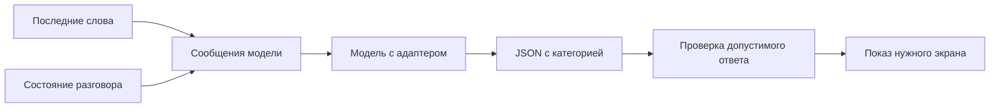
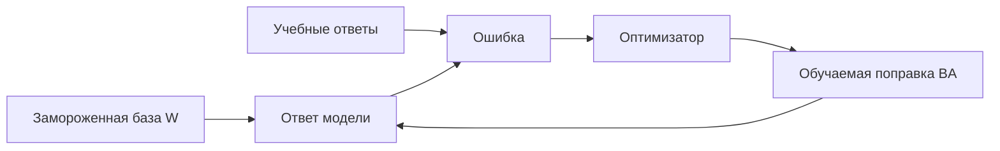

# Дообучение небольшой модели на синтетических диалогах

> **Где мы находимся.** В [уроке 3](../03-decisions.md) программа передавала обращение модели и получала выбранную категорию. Правила мы задавали в инструкции, а веса модели оставались прежними. Теперь разберем другой способ настройки: обучение на примерах правильных ответов. Для этого подготовим отдельную лабораторию с обращениями читателей библиотеки и проследим, как из строки с разметкой получается обучаемый адаптер.

Сначала пройдите основные уроки 1 и 3. Для чтения этого дополнения и проверки данных видеокарта не нужна. Для предложенного запуска обучения нужен отдельный компьютер с NVIDIA CUDA и достаточно памяти. Это дополнительная лабораторная работа; требования семи основных уроков остаются прежними.

На 02.11.2026 в этой лаборатории проверены подготовка и разделение данных, логика маски ответа на подставном токенизаторе, синтаксис скриптов и состав архива. Обучение весов на библиотечном наборе и измерение качества модели еще не выполнялись. Вы сможете повторить подготовку без модели, а при наличии подходящей видеокарты - провести собственный эксперимент по приведенным командам.

Скачайте [архив с кодом и датасетом](../../downloads/fine-tuning-dialogues.zip?raw=true), распакуйте его через **Извлечь всё** и откройте папку `fine-tuning-dialogues` в PyCharm через **File -> Open**. В этой лаборатории скрипты уже написаны: сначала будем разбирать и запускать их, затем вы сможете изменить примеры самостоятельно. Первый запуск без моделей приведен в разделе 6; до него выясним, какие данные он проверяет.

## 1. Какую задачу решаем

Представьте форму для читателей библиотеки. Человек пишет сообщение, а программа определяет, какой экран показать библиотекарю. Она пока не меняет срок выдачи и не отправляет сообщения читателю. Ее единственный результат - одна из четырех категорий.

| Категория в коде | Что означает | Пример |
|---|---|---|
| `renew` | Прямая просьба продлить известную выдачу книги | "Продлите выдачу книги Маяк на острове на неделю" |
| `find` | Просьба найти книгу | "Покажите карточку книги Атлас старых дорог" |
| `question` | Вопрос о правилах или отказ от изменения | "Вы умеете продлевать книги?" |
| `clarify` | Для понимания не хватает предмета разговора | "Еще на неделю", когда неизвестно, о чем речь |

Рассмотрим последнюю строку таблицы подробнее. Если человек открыл пустую форму и написал "Еще на неделю", программа должна запросить уточнение: неизвестно, срок какой выдачи он хочет изменить. Теперь изменим только состояние формы: пусть в ней уже выбрана книга "Письма с орбиты". Те же слова относятся к выбранной выдаче, поэтому по правилам нашего учебного примера ожидается категория `renew`.

Чтобы модель могла различить эти случаи, программа передает вместе с репликой сведения о текущем разговоре. Эти сведения называются контекстом. В нашем примере достаточно поля `current_loan`, в котором записано название выбранной книги:

| Слова читателя | Переданный контекст | Ожидаемый ответ |
|---|---|---|
| "Еще на неделю" | `{}` | `{"category": "clarify"}` |
| "Еще на неделю" | `{"current_loan": "Письма с орбиты"}` | `{"category": "renew"}` |

Это примеры правильной разметки, а не результаты запуска модели. Предыдущие сообщения целиком в набор не входят: состояние разговора уже сведено к одному полю. Такое упрощение позволяет отдельно проверить, учитывает ли модель переданный контекст. Если приложение оставит это поле пустым, сведений о выбранной книге в запросе не будет.



Схема показывает, где результат модели мог бы использоваться в приложении. В архиве мы реализуем только выбор категории и проверку ответа; формы и библиотечной базы там нет. Если позже подключить настоящее продление, программа должна отдельно проверить номер выдачи и библиотечные правила. Категория `renew` сообщает о намерении читателя, но сама по себе не подтверждает, что продление разрешено или уже выполнено.

## 2. Сначала проверьте, действительно ли требуется обучение

Допустим, программа передала выбранную книгу, однако модель вернула `clarify` для просьбы "Еще на неделю". Прежде чем менять веса, стоит сохранить весь запрос и проверить инструкцию: понятно ли из нее, как использовать `current_loan`? Возможно, достаточно уточнить это правило и добавить в промпт пару примеров.

Если при понятной инструкции ошибки повторяются на разных обращениях, можно исследовать дообучение, или fine-tuning. Во время него программа меняет числовые параметры модели на примерах нужного поведения. Мы заранее указываем правильные категории и проверяем, помогает ли такая настройка отвечать на новые формулировки.

Если модель не увидела выбранную книгу, исправьте передачу контекста. Если она дала правильную категорию, но программа открыла другой экран, исправьте код. Если нужна актуальная доступность книги, запросите каталог. Обучение не заменяет эти части системы.

Для сравнения понадобятся отложенные примеры: обращения, на которых параметры не менялись. Исходная модель и версия с адаптером получат одинаковые входы, а мы сравним их ответы с разметкой. Скрипт такого сравнения разобран в разделе 11. Пока будем готовить данные так, чтобы знакомые учебные фразы не подменили проверку новых.

| Средство | Что меняется | Для чего подходит |
|---|---|---|
| Промпт | Текст инструкции перед очередным ответом | Описать задачу и формат |
| Контекст | Сведения о текущем разговоре | Понять "ее", "еще неделю", "ту книгу" |
| Поиск или API | Получаемые внешние факты | Узнать наличие книги сейчас |
| Код | Проверки и выполнение действия | Не создать две записи, проверить номер выдачи |
| Дообучение | Часть весов модели | Закрепить нужное поведение на разнообразных примерах |

## 3. Базовая модель и небольшой обучаемый адаптер

Для лаборатории возьмем текстовую `Qwen/Qwen3-0.6B`, уже обученную языковую модель. Ее исходные веса будем называть базой. Обозначение `0.6B` указывает на размер порядка 0.6 миллиарда параметров; устройство и файлы описаны в [карточке разработчика Qwen](https://huggingface.co/Qwen/Qwen3-0.6B). Такой размер удобен для разбора небольшой модели, хотя качество на нашей задаче еще предстоит измерить.

Мы закрепили ревизию `c1899de289a04d12100db370d81485cdf75e47ca`. Ревизия - идентификатор конкретного состояния файлов. Если у автора появятся новые веса под тем же названием, наш загрузчик продолжит запрашивать прежние. Это помогает повторять опыт. Скрипт `get_model.py` сохраняет название и ревизию в `provenance.json` рядом с моделью.

У готовой модели можно дообучать все веса, но тогда для них придется хранить градиенты и состояния оптимизатора. В этой лаборатории используем LoRA, Low-Rank Adaptation: к некоторым слоям базы добавим небольшие обучаемые матрицы. Вместе эти добавления образуют адаптер. Базовые веса останутся замороженными, то есть программа не будет менять их при обучении. Подключение адаптера выполняет библиотека [PEFT](https://huggingface.co/docs/peft/en/quicktour).

Для одного линейного слоя идея выглядит так:

$$W_{new} = W + \frac{\alpha}{r}BA$$

`W` - исходная таблица чисел слоя. `A` и `B` - две меньшие обучаемые таблицы. Их произведение `BA` дает поправку нужного размера. `r` называется рангом: он задает внутреннюю ширину этой поправки. `alpha` управляет ее масштабом. В скрипте `r = 8`, `alpha = 16`, поэтому коэффициент равен `16 / 8 = 2`.

Предположим только для объяснения, что `W` имеет размер `1000 x 1000`. В ней миллион чисел. Для ранга 8 матрицы `A` и `B` имеют размеры `8 x 1000` и `1000 x 8`. Вместе это `8000 + 8000 = 16000` обучаемых чисел. Это пример арифметики, а не размеры конкретного слоя Qwen.

Вместо миллиона исходных чисел в этом условном слое мы настраиваем 16000 дополнительных. При вычислении ответа участвуют и база, и поправка, поэтому исходные веса по-прежнему должны находиться в памяти. После обучения скрипт сохранит только адаптер и его настройки; для использования понадобится та же совместимая база.



## 4. Откуда взялся датасет

Вернемся к библиотечным обращениям. Чтобы настраивать адаптер, нужны входные данные и заранее заданные правильные ответы. Такой набор называется датасетом. В этой лаборатории он синтетический: обращения собраны программой из специально придуманных шаблонов и вымышленных названий книг. Генерации другой языковой моделью здесь нет, как нет и личной переписки читателей.

Откройте `prepare_data.py` и найдите словарь `SCENARIOS`. В разделе `find` есть шаблон "Найдите в каталоге книгу {book}". Функция `build_records` подставляет вместо `{book}` название "Маяк на острове" и сохраняет категорию `find`. Эта заранее заданная категория называется меткой, или label. Ее определяют правила генератора; правильность самих правил остается задачей автора набора.

Это маленький **учебный** набор: всего 54 строки. Он помогает увидеть все этапы и быстро заметить ошибку формата. Для выпуска настоящей системы такой объем и однообразие недостаточны.

| Файл | Строк | Для чего используется |
|---|---:|---|
| `data/train.jsonl` | 36 | Изменять обучаемые параметры |
| `data/dev.jsonl` | 9 | Проверять выбранные настройки при разработке |
| `data/exam.jsonl` | 9 | Один раз оценить выбранный вариант после настройки |
| `data/manifest.json` | - | Проверить состав и контрольные суммы файлов |

JSONL - обычный текст, в котором каждая строка является отдельным JSON-объектом. Его можно открыть в PyCharm. Для удобства чтения здесь одна строка развернута на несколько:

```json
{
  "id": "context-0-1",
  "template_group": "context-0",
  "split": "train",
  "utterance": "Еще на неделю",
  "context": {"current_loan": "Письма с орбиты"},
  "expected": "renew"
}
```

В этой записи `utterance` содержит слова читателя, а `context` сообщает, что выбрана книга "Письма с орбиты". По нашему правилу правильной категорией будет `renew`, поэтому именно она записана в `expected`. При обучении из нее получится образец ответа. Во время проверки программа оставит `expected` у себя и использует его для сравнения с тем, что сгенерировала модель.

Остальные поля нужны для сопровождения опыта: по `id` можно найти ошибку в отчете, `split` указывает часть набора, а `template_group` объединяет варианты одной формулировки. Например, замена названия книги не делает шаблон "Найдите в каталоге книгу {book}" новым способом выразить просьбу.

Рядом лежит контрастный пример: те же слова с пустым `context` и меткой `clarify`. Контрастный означает, что почти одинаковые входы специально требуют разных ответов. Такое упражнение проверяет влияние контекста.

## 5. Почему нельзя перемешать все строки случайно

Представьте, что в обучение попал "Найдите Маяк на острове", а в экзамен - тот же шаблон с другим названием. Модель может справиться за счет знакомой формы. Это слабая проверка нового способа выразить мысль.

В нашем генераторе разделение делается до подстановки книг:

```python
split = "train" if index < 4 else "dev" if index == 4 else "exam"
```

Здесь `index` - номер формулировки внутри группы, отсчет начинается с нуля. Значения от 0 до 3 дают `train`, значение 4 дает `dev`, а оставшееся значение 5 дает `exam`. Поэтому первые четыре формулировки каждого типа идут в обучение, пятая - в разработку, шестая - в экзамен. Все названия книг, подставленные в одну формулировку, остаются в одной части.

Функция `validate_records` проверяет, что одно семейство `template_group` не оказалось в разных частях. Она также запрещает повторять один и тот же вход: сочетание реплики и контекста. Две строки "Еще на неделю" допустимы, поскольку контекст у них разный; точная копия одной из этих строк вызовет ошибку.

Это еще не полностью независимый экзамен: автор шаблонов один, задачи и словарь во многом общие. Поэтому после первых опытов нужны новые формулировки других авторов, длинные разговоры, опечатки и смена темы. Просто добавить еще тысячу названий книг в те же шаблоны недостаточно.

В `manifest.json` записан SHA256 каждого файла. SHA256 - контрольный отпечаток байтов. Если изменить хотя бы строку, отпечаток почти наверняка изменится. Он помогает проверить неизменность набора, но не доказывает правильность его меток.

## 6. Первый запуск без моделей

Откройте терминал в папке распакованного примера:

```powershell
python check_data.py
python prepare_data.py --output data-rebuilt
```

Команды выполняйте в терминале PyCharm из папки `fine-tuning-dialogues`, где лежит `check_data.py`. Первая запускает четыре проверки: состава набора и контрастной пары, разделения шаблонов, маски ответа и отказа для слишком длинного примера. При успешном запуске в конце появится `OK`.

Модель для этого не загружается. В проверке маски используется маленький подставной токенизатор: он позволяет проверить, какие позиции мы исключили из ошибки, но не подтверждает работу настоящего токенизатора Qwen. К нему перейдем после скачивания базы.

Вторая команда заново собирает набор и выводит число строк: `{"train": 36, "dev": 9, "exam": 9}`. Исходные данные уже лежат в `data`, поэтому для новой копии выбрано имя `data-rebuilt`.

Если `data-rebuilt` уже существует, скрипт остановится. Укажите новое имя; прежний эксперимент не должен тихо потерять данные. Сравнить отпечатки можно так:

```powershell
Get-FileHash data/train.jsonl -Algorithm SHA256
Get-FileHash data-rebuilt/train.jsonl -Algorithm SHA256
```

На этом этапе не скачиваются веса и не используется видеокарта. Вы уже можете изучать и менять подготовку примеров.

## 7. Какие файлы читать по порядку

| Файл | Что найти сначала |
|---|---|
| `prepare_data.py` | `SCENARIOS`, затем `build_records`, `validate_records`, `main` |
| `data_contract.py` | Категории, общую инструкцию, `make_messages`, `make_training_tokens` |
| `check_data.py` | Как проверяется код без большой модели |
| `get_model.py` | Название и закрепленную ревизию базы |
| `train_adapter.py` | Загрузку, LoRA, цикл обучения, сохранение |
| `evaluate_adapter.py` | Одинаковую проверку базы и кандидата |

Начните с `data_contract.py`: в нем записана общая для обучения и проверки договоренность о входе и ответе. Ее здесь называем контрактом. Один файл нужен, чтобы инструкция, названия категорий и способ передачи контекста оставались одинаковыми в обоих режимах.

Проследим запись `context-0-1` из раздела 4. Вызов `make_messages(record)` получает весь словарь записи через параметр `record` и возвращает список из двух сообщений. Первое, с ролью `system`, содержит инструкцию из `SYSTEM_MESSAGE`: определения категорий и требование вернуть JSON. Во втором, с ролью `user`, поле `content` содержит такой текст:

```json
{"utterance": "Еще на неделю", "context": {"current_loan": "Письма с орбиты"}}
```

Поля `id`, `split` и `expected` в эти сообщения не попадают. Отдельный вызов `make_target(record)` читает `expected` и возвращает строку `'{"category": "renew"}'`. При обучении она станет продолжением диалога, которое модель должна научиться предсказывать. При проверке продолжение будет создавать сама модель.

## 8. Как текст становится учебной задачей

Подготовленные сообщения пока содержат обычный текст. Для вычислений модели нужны номера токенов, поэтому их обрабатывает токенизатор: делит текст на элементы своего словаря и заменяет каждый целым числом. Такой элемент может соответствовать слову, части слова или знаку. Длина текста в буквах и длина входа в токенах поэтому различаются.

Сначала функция `make_training_tokens` вызывает `apply_chat_template`. Он оформляет сообщения по правилам Qwen: добавляет служебные метки ролей и начало ответа ассистента. Затем метод `encode` превращает получившийся текст в номера токенов. Для Qwen3 задано `enable_thinking=False`, чтобы использовать режим без отдельного рассуждения перед ответом. Формат описан в [документации Qwen3](https://huggingface.co/docs/transformers/model_doc/qwen3).

Посмотрите на конец `make_training_tokens`:

```python
input_tokens = prefix + target
labels = [-100] * len(prefix) + target
```

В `prefix` находятся токены инструкции, реплики с контекстом и начала ответа. В `target` - токены правильного JSON и маркера завершения ответа `eos_token`. Сложение списков соединяет их в одну последовательность `input_tokens`.

Рядом формируется список `labels` той же длины. Он указывает, какие токены считать правильными ответами при вычислении ошибки. На местах входной инструкции записывается `-100`: это специальное значение "пропустить эту позицию", которое понимает функция ошибки. На местах ответа остаются его настоящие номера токенов.

Для наглядности возьмем вымышленные номера: пусть у входа всего три токена, а у ответа два. Тогда списки будут такими:

```python
prefix = [11, 12, 13]
target = [21, 22]
input_tokens = [11, 12, 13, 21, 22]
labels = [-100, -100, -100, 21, 22]
```

Эти числа показывают устройство списков; к реальному разбиению русской фразы токенизатором Qwen они не относятся. Маска в `labels` исключает входные позиции из подсчета ошибки. При этом сам вход остается доступен модели: иначе она не смогла бы связать категорию с выбранной книгой.

Так мы учитываем ошибку при предсказании ответа на обращение и не включаем в нее воспроизведение входной инструкции. Модель предсказывает следующий токен по предыдущим, а класс языковой модели сам сдвигает предсказания и метки при вычислении потери. В условном примере предсказание после токена `13` сравнивается с меткой `21`, следующее - с `22`. Дополнительного сдвига в нашем скрипте нет.

Во время обучения правильное продолжение входит в последовательность: предсказывая очередной токен ответа, модель получает предыдущие правильные токены. При обычном использовании правильного продолжения нет, и каждый следующий токен строится с учетом уже сгенерированных. Поэтому проверка на новых обращениях нужна даже при низкой ошибке на обучении.

Перед возвратом функция проверяет длину. Если пример превышает 1024 токена, она останавливает запуск. Молчаливое обрезание могло бы удалить правильный ответ или ту часть контекста, которая меняет смысл.

## 9. Что означает потеря и как меняются параметры

Модель дает вероятность каждому возможному следующему токену. При обучении мы знаем правильный токен. Функция ошибки, или loss, штрафует модель, когда его вероятность мала.

Для одного правильного токена штраф равен:

$$L = -\ln p$$

`p` - вероятность правильного токена, `ln` - натуральный логарифм. Если `p = 0.8`, штраф примерно `0.223`. Если `p = 0.1`, штраф примерно `2.303`: уверенное ожидание другого ответа обходится дороже. Для последовательности вычисляется среднее по нужным позициям ответа.

В тренере это выглядит так:

```python
output = model(input_ids=input_tensor, attention_mask=torch.ones_like(input_tensor), labels=label_tensor)
loss = output.loss
loss.backward()
optimizer.step()
```

Перед этим вызовом списки преобразуются в тензоры PyTorch - массивы чисел, с которыми выполняются вычисления на видеокарте. В `input_tensor` находится одна строка с номерами токенов. Аргумент `labels` передает правильные токены и отметки `-100`, которые мы только что разобрали.

Параметр `attention_mask` решает другую задачу: отмечает настоящие позиции входа. Здесь каждый пример обрабатывается отдельно, без добавления заполнителей, поэтому `torch.ones_like(input_tensor)` создает маску из единиц. Она не заменяет маску в `labels`: модель должна учитывать всю инструкцию, хотя ошибка считается только на ответе.

После вызова модели в `output.loss` находится одно число - средняя ошибка на учитываемых токенах. Метод `backward()` вычисляет градиенты, то есть производные этой ошибки по обучаемым параметрам. Они описывают, как небольшое изменение каждого параметра повлияло бы на ошибку. Оптимизатор AdamW использует эти значения при вызове `optimizer.step()` и обновляет параметры адаптера. Базовые веса при этом остаются прежними.

Скорость обучения `0.00002`, заданная как `lr` при создании AdamW, управляет масштабом обновлений. Ее влияние зависит и от самого оптимизатора, поэтому это число нельзя понимать как величину, которую прибавляют к каждому весу. В лаборатории оно служит начальной настройкой эксперимента.

Перед следующим примером `optimizer.zero_grad` очищает прежние градиенты. Без этого они продолжали бы накапливаться. `clip_grad_norm_` ограничивает общий размер градиента, чтобы одиночный резкий шаг не оказался слишком большим. Проверка `isfinite` останавливает обучение, если ошибка стала бесконечностью или неопределенным числом.

В нашем скрипте один пример дает один шаг. Одна эпоха - проход по всем 36 обучающим строкам. Две эпохи дают `36 x 2 = 72` шага. Это важно отличать от другого режима, где несколько примеров накапливаются перед одним обновлением.

Понижение loss на обучении само по себе не доказывает улучшение. Модель могла запомнить знакомые фразы и хуже отвечать на новые.

## 10. Как подготовить окружение для собственного опыта

Теперь можно перейти от разбора к собственному запуску. В терминале PyCharm, открытом в папке `fine-tuning-dialogues`, создайте отдельное окружение на Python 3.12. Обучение использует Transformers, PEFT и PyTorch, поэтому ему выделим свою `.venv`, сохранив общее окружение `agent-venv` для основных уроков.

```powershell
py -3.12 -m venv .venv
.venv\Scripts\Activate.ps1
python -m pip install --upgrade pip
```

Установите PyTorch по [официальному селектору](https://pytorch.org/get-started/locally/), выбрав Windows, Pip и вариант CUDA для своего компьютера. Затем:

```powershell
python -m pip install -r requirements.txt
python -c "import torch; print(torch.cuda.is_available())"
python get_model.py
```

Команда с `torch.cuda.is_available()` должна вывести `True`, прежде чем вы перейдете к обучению. Значение `False` означает, что установленный PyTorch сейчас не может использовать CUDA; проверьте выбранную сборку и драйвер по инструкции PyTorch. Подготовку данных при этом можно продолжать на CPU.

Команда `python get_model.py` скачивает базу с Hugging Face в `models/qwen3-0.6b` и записывает сведения об источнике в `provenance.json`. При последующих запусках обучение читает эти файлы локально: в загрузчиках стоит `local_files_only=True`. Параметр `trust_remote_code=False` задает загрузку через поддерживаемую реализацию из установленной библиотеки, без подключения произвольного кода из репозитория весов.

Диапазоны версий в `requirements.txt` описывают требования примера. Они не означают, что все их сочетания проверены. Перед реальным опытом сохраните точные версии своего окружения:

```powershell
python -m pip freeze > environment-lock.txt
```

Этот тренер использует FP32: по четыре байта на число. Так первый пример проще разобрать, но память расходуется сильнее, чем при BF16. Дополнительно нужны активации и состояния оптимизатора. По размеру файла модели нельзя точно предсказать необходимую видеопамять. Измерение минимальной памяти для этого примера еще не выполнено.

## 11. Команды обучения и проверки

Когда окружение готово, запуск выглядит так:

```powershell
python train_adapter.py --base models/qwen3-0.6b --output runs/attempt-01 --epochs 2
```

Параметр `--base` указывает на скачанные исходные веса, а `--output` задает новую папку опыта. В нее попадут адаптер и отчет; если папка уже существует, скрипт остановится, поэтому для повторного опыта выберите, например, `runs/attempt-02`. Параметр `--epochs 2` означает два прохода по обучающим данным.

По умолчанию тренер читает `data/train.jsonl`. Он проверяет поле `split` каждой строки и принимает только значение `train`, поэтому случайная передача экзаменационного файла через `--data` вызовет ошибку.

В `LoraConfig` указаны `q_proj` и `v_proj` - имена проекций внимания, к которым подключается поправка. Сейчас не обязательно изучать все устройство внимания. Достаточно понимать, что адаптер вставляется в определенные слои, а не во все параметры подряд.

`gradient_checkpointing_enable` экономит память: часть промежуточных значений вычисляется повторно, когда потребуется градиент. Это обмен скорости на память. В конце `save_pretrained` сохраняет адаптер и его настройки, а `training-report.json` - версии библиотек, ревизию базы, хеш набора, параметры запуска и потери.

После успешного завершения откройте `runs/attempt-01`. В папке `adapter` должны находиться сохраненные файлы адаптера, а рядом - `training-report.json`. Статус `trained_not_evaluated` в отчете означает, что цикл обучения завершен, но качество еще не оценено. Следующая команда выполняет именно такую оценку на наборе разработки:

```powershell
python evaluate_adapter.py --base models/qwen3-0.6b --adapter runs/attempt-01/adapter --data data/dev.jsonl --device cpu --output runs/dev-cpu.json
```

Здесь `--adapter` указывает на результат обучения, `--data` - на отложенные обращения, а `--output` - на новый файл отчета. Параметр `--device cpu` позволяет выполнить ответы на процессоре, даже если обучение проводилось на видеокарте.

Скрипт загружает одну базу с адаптером и дважды проходит по одному набору. Для варианта `baseline` он выключает адаптер через `disable_adapter`, для `candidate` использует его. Поскольку базовые веса были заморожены, первый проход соответствует исходной модели. В обоих проходах одинаковы сообщения и способ генерации. Параметр `do_sample=False` убирает случайный выбор токенов, хотя побитовая воспроизводимость на любых устройствах этим не гарантируется.

Посмотрите ошибки на `dev`. Если меняете данные или настройки, повторяйте проверку разработки. Когда вариант выбран, запустите один финальный экзамен:

```powershell
python evaluate_adapter.py --base models/qwen3-0.6b --adapter runs/attempt-01/adapter --data data/exam.jsonl --device cpu --output runs/exam-cpu.json
```

Просмотренный экзамен нельзя бесконечно использовать как совершенно новый. Если по его ошибкам вы переделали обучение, прежний файл стал регрессионной проверкой известных проблем. Подготовьте новый отложенный набор для следующей оценки.

## 12. Что считать улучшением

Откройте `runs/dev-cpu.json` в PyCharm и найдите раздел `results`. Внутри находятся `baseline` и `candidate`, у каждого - число примеров `count`, число допустимых ответов `valid`, число правильных категорий `correct` и список отдельных случаев `cases`.

Допустимый ответ должен быть JSON-объектом с единственным ключом `category` и одним из четырех известных значений. Например, `{"category": "find"}` проходит проверку формата, но для нашей реплики "Еще на неделю" с выбранной книгой это неверная категория. Тогда у случая будут `valid: true` и `correct: false`. Ответ с лишними пояснениями вокруг JSON не пройдет проверку формата и тоже будет засчитан как неправильный.

$$Accuracy = \frac{N_{correct}}{N_{all}}$$

`N_correct` - число верных категорий, `N_all` - число проверенных примеров. Например, **в вымышленном расчете** семь верных ответов из девяти дают примерно `77.8%`. Один ответ на таком маленьком экзамене меняет показатель сразу на `11.1` процентного пункта. Это объясняет, почему нельзя делать сильные выводы по девяти строкам.

Сначала сравните `correct` у базы и кандидата, затем откройте `cases` и найдите строки, в которых результаты разошлись. Поле `id` позволит вернуться к исходной записи датасета, а `answer` покажет настоящий текст модели. Проверьте по этой записи, верна ли разметка и достаточно ли передано контекста; после этого можно разбирать ошибку категории или формата.

Особенно внимательно смотрите, не стала ли модель принимать вопрос о возможности за просьбу изменить выдачу. Даже при росте общего числа правильных ответов такая ошибка может стать чаще. На девяти примерах полезнее перечислить конкретные исправленные и новые ошибки, чем ограничиться одним процентом.

В этом примере модель генерирует категорию. Мы не называем ее результат откалиброванной вероятностью. Если нужна уверенность и автоматическое решение по порогу, потребуется отдельная методика калибровки на отдельной части данных, как обсуждалось в уроке 3. Число, которое модель сама написала в ответе, не становится от этого надежной оценкой уверенности.

## 13. CPU, GPU и готовая программа

Обучение и использование - разные процессы. Обучение хранит промежуточные вычисления и считает градиенты, поэтому требует больше памяти. Для ответа уже обученной модели градиенты не нужны.

Предложенный тренер намеренно требует CUDA. Подготовка данных, их проверки и чтение отчета работают на CPU. `evaluate_adapter.py --device cpu` выполняет ответ на процессоре через Transformers в FP32. Он не использует видеокарту скрытно.

Это еще не проверка GGUF и llama.cpp из основного курса. Для доставки адаптера в другой движок нужны совместимый экспорт и отдельное сравнение. Квантование, другая инструкция или другое ограничение JSON могут изменить ответы. Нельзя перенести число качества из одного режима и объявить, что другой проверен.

Скорость измеряйте после отдельного холодного запуска и затем на нескольких повторных запросах. Пока параллельно идет обучение или другая тяжелая работа, замер не является чистым сравнением быстродействия.

## 14. Что сделать самостоятельно

1. Найдите пару "Еще на неделю" и объясните, почему правильные ответы различаются.
2. Добавьте новый тип контекста: выбраны две выдачи. До вызова модели решите, какой результат ожидается и почему.
3. Попросите другого человека написать десять новых обращений, не показывая ему шаблоны. Сначала разметьте их, затем сравните результаты.
4. Создайте пример с отрицанием и пример с цитатой чужой команды. Проверьте, не превращаются ли они в действие.
5. Объясните по коду, почему в архиве есть тренер, но нельзя сказать, что обучение уже выполнено.

Для проверки своего понимания вернитесь к записи `context-0-1`. Найдите, как `make_messages` передает выбранную книгу, как `make_target` строит ответ `renew` и как `make_training_tokens` оставляет этот ответ в метках для вычисления ошибки. Затем проследите, где тренер обновляет и сохраняет адаптер. После собственного запуска сравнения вы сможете по отдельным ответам установить, изменилось ли поведение на новых обращениях.

Вернуться к остальным материалам можно через [список уроков и каркасов](../README.md).

## Проверяемые источники

[Карточка Qwen3-0.6B](https://huggingface.co/Qwen/Qwen3-0.6B) описывает исходную модель. [Документация Qwen3 в Transformers](https://huggingface.co/docs/transformers/model_doc/qwen3) объясняет ее загрузку и шаблон сообщений. [PEFT Quicktour](https://huggingface.co/docs/peft/en/quicktour) показывает подключение и сохранение LoRA. [Установка PyTorch](https://pytorch.org/get-started/locally/) нужна для выбора сборки под оборудование. Наши библиотечные примеры не взяты из этих источников: они созданы специально для урока.
